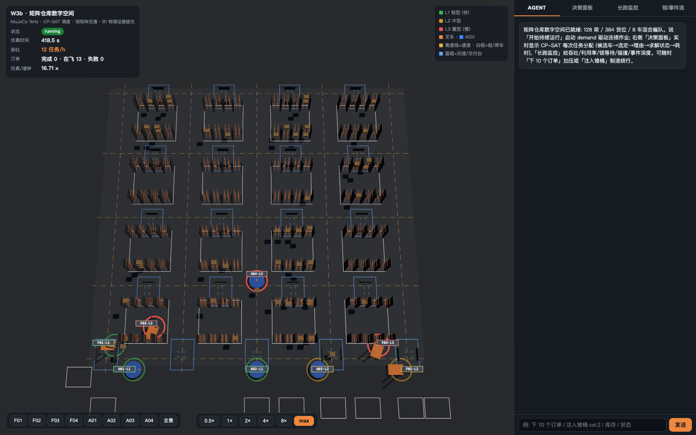
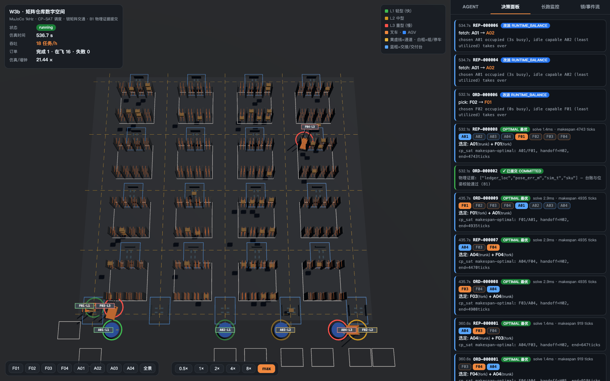
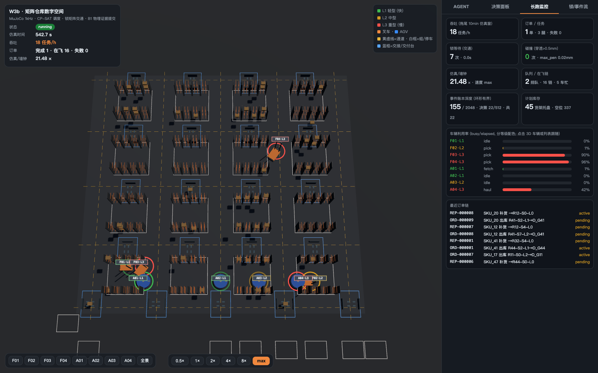
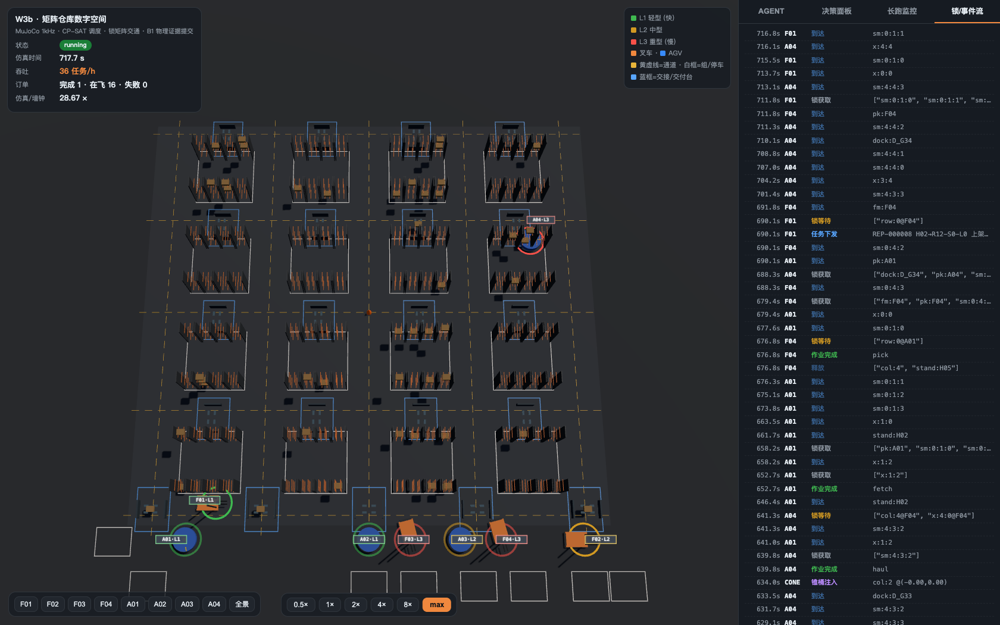

<p align="center">
  
</p>

# AGV World Model：物理证据门控的 Agentic 仓储世界模型

> **语言 / Language:** 中文为主 · English overview follows。

**English**: An agentic world model for warehouse management in which an LLM/rule agent
is the *only* command entry, physical execution runs in a contact-faithful MuJoCo engine,
and inventory facts commit to a transactional ledger **only when sensor evidence
(support ratio, contact, withdrawal clearance) proves them**.

`Purpose: NATIVE AI` · `Type: WORLD MODEL / PHYSICS KERNEL` · `Evidence: 1200-RUN ABLATION`

    

> 属于 **TopPrism Native AI** — 让组织级机器学习能力在跨项目实践中持续复利的工程体系。

## Why this exists

物流与仓储仿真普遍"执行不可信"：感知出告警就止步，物理成败与账本事实脱节，
状态正确性没有证据链。

> **核心命题**：*具身智能的深层价值不是替代体力，而是把物理执行变成
> 持续可观测、可验证、可学习的过程。* Agent 可以改变计划，但不能改变
> 未经物理验证的事实。

成熟工业实践（PLC 状态字 ACK + 幂等 + journal 对账）在 1200 runs 故障注入
消融中仍有 **11.1% 不安全提交**（半托/滑落类：设备字不承载力学证据）；
物理证据门控将其压到 **0**。这个增量就是本项目存在的理由。

> 全文论证见 [docs/agentic_world_model_literature.md](docs/agentic_world_model_literature.md)。

## 界面一览（:8400 矩阵仓库）

| 全景（4×4 矩阵 · 8 车 · 384 货位） | 决策面板（CP-SAT 分配可观察） |
|---|---|
|  |  |

| 监控面板（利用率/倍率/吞吐） | 锥桶注入（通道锁绕行） |
|---|---|
|  |  |

## M2：128 架矩阵仓库（当前主线）

4×4 货架组矩阵 × 每组 8 架 × 3 层 = **384 货位**；**8 辆异构车队**
（F01-F04 叉车 + A01-A04 潜伏顶升 AGV，承重 L1/L2/L3 三级、能力强速度慢）；
需求驱动 24h continuous 运行。

```
自然语言 ⇄ WarehouseAgent (本地 omlx LLM 工具循环 + 规则兜底)
   │ 订单/查询/锥桶注入/持续运行                 ← 唯一指令入口
   ▼
调度层 Dispatcher (OR-Tools CP-SAT: 能力约束·时间窗·100ms tick)
   │ 决策事件流: 候选→选择→solver_status→solve_ms    ← 决策面板可观察
   ▼
导航层 NavGraph (330 节点 A* + 巷道/交叉口锁矩阵, Space-Time A* 软化)
   ▼
物理层 MuJoCo (WarehouseCell: 8 车/384 货位/地面标志线/锥桶避障)
   ▼
观测层 ObservationChannel (LiDAR 扫描估计, 决策侧零真值引用)
   ▼
事务层 World.commit_transfer (原子: 乐观版本→变更→事件→证据→幂等)
   ▼
展示层 :8400 矩阵前端 (决策面板/监控面板/事件流/库存板)
```

**六大红线架构**（经 GPT 深度评审三轮迭代）：

1. **单一指令入口**——agent 只能提交意图，物理执行走判据层
2. **物理证据门控**——`EvidenceVerdict` 五门联合判据（承托率≥95% ∧ 卸载≤5% ∧ 0.5s 稳定 ∧ 静止 ∧ 位姿≤10mm），11 帧采样版本化
3. **原子事务**——`commit_transfer` 单 SQLite 事务；物理成功而提交失败 → `RECONCILIATION_REQUIRED` 挂起，reconcile 同键幂等恢复
4. **观测隔离**——决策侧（agent/调度/记忆）零真值引用（AST 强制）；估计偏差 bias≈0（无泄漏）且 std>0（有噪声）
5. **需求真实性**——40 SKU 目录与需求曲线由 Kaggle 456 万行真实零售数据标定（周内/月度因子 + 噪声）
6. **利用率运营闭环**——滑动窗 <60% 自动升需求倍率（DemandTuned 决策事件），24h continuous

## 在线演示（本地）

```bash
# M2 矩阵仓库 (推荐): 8 车 · 384 货位 · 决策面板 · 需求驱动
PYTHONPATH=. python twin/matrix_server.py    # http://127.0.0.1:8400

# 旧双车演示 (P3 时代, 保留)
PYTHONPATH=. python twin/server.py           # http://127.0.0.1:8300
```

对 Agent 说：`开始持续运行`（24h 需求驱动）· `下 10 个订单` · `前方放个锥桶挡住`（通道锁绕行）· `库存` · `利用率`。

决策面板实时显示每次任务分配：候选车 → 选择理由 → CP-SAT 求解状态（OPTIMAL/FEASIBLE/FALLBACK_GREEDY）→ solve_ms → COMMITTED；监控面板显示车队利用率、吞吐、锁等待、碰撞计数与需求倍率。

## 分层模块

| 层 | 模块 | 要点 |
|---|---|---|
| 物理 | `sim/warehouse_cell.py` | 128 架矩阵程序化生成 + 地面标志线（LAYOUT 单一来源，改参数线跟动）；混合车队模板（叉车 2-DOF+门架 / AGV 圆盘+顶销） |
| 需求 | `sim/demand.py` | 泊松订单流（周内/月度因子），同 seed 逐单可复现；出库/补货双流 |
| 调度 | `sim/dispatch.py` | CP-SAT 逐腿指派（能力/NoOverlap/交接链/占用窗），贪心暖启动 0.5s 封顶，失败回退贪心；实测 makespan 严格优于贪心 |
| 导航 | `sim/navigation.py` | 330 节点图全 LAYOUT 派生；状态 A*（距离+转弯+锁惩罚）；作业前 x 向闭环对中 |
| 锁 | `sim/traffic.py` | lane+节点锁矩阵，原子整路由（等待图无环防死锁定理），滞后释放 |
| 任务 | `sim/mission.py` | 4 类任务相位机 + 台账 + 作业后物理校验 |
| 观测 | `twin/observation.py` | `front_obstacle`/`cone_estimate`/`clear_confirmed`（连续 N 次扫描才恢复） |
| 事务 | `services/world/ontology.py` | `commit_transfer` + `execution_evidence` 表 + 幂等登记 |
| 证据 | `services/world/evidence.py` | `EvidenceVerdict` 版本化五门判据 |
| 记忆 | `twin/memory.py` | 情境签名（观测估计）→ 处置 → 结局，只提示不自动重放 |
| 前端 | `twin/web/matrix.html` | 决策面板/监控面板/事件流/矩阵渲染 |

## 验证体系

- **300+ pytest 用例**（物理往返/交接链/避障/原子性/观测隔离/调度/8 车并发）
- **故障注入**：事务内 5 断点参数化注入零残留；进程级退出（D02/D03/D06）重启恢复；恢复后账本与无故障 E2E 逐位一致
- **Paper I 消融**（`experiments/fault_ablation.py`，**1200 runs 主实验**（4 组×10 场景×30 seed，`reports/ablation_n30.json`，6/6 预注册假设 PASS，与 3-seed 试点逐位一致））：

| 指标 | B0 无门控 | B4 工业强基线 | B1 仅门控 | B2 门控+事务 | B3 完整 |
|---|---|---|---|---|---|
| Unsafe 提交率 | 61.9% | **11.1%** | 4.8% | 0 | **0** |
| 原子性违规 | 100% | 0 | 100% | 0 | **0** |
| 故障恢复率 | 0 | 100% (0.08s) | 0 | 25% (2.59s) | **100%** (0.31s) |
| 任务完成率 | 20% | 80% | 60% | 70% | **100%** |

  B4 工业强基线 = PLC 状态字 ACK + op_id 幂等 + journal 重启对账 + 重试
  (无证据门控、不读真值) —— 成熟工业实践仍有 11.1% 不安全提交
  (半托/滑落类: 设备字不承载力学证据), 证据门控的增量价值以强基线计量

  三档机制（物理门控 → 原子事务 → 恢复对账）各自挡住哪类故障逐层可见；B3 组跑生产代码全链（prepare→evidence→commit→recover→真实重启）；故障对照演示 `--demo S01`（同故障下 B0 提交从未发生的取货 vs B3 拒绝→重试真取→账实闭合）
- **8 车满并发物理收敛已闭**（DetFix）：t=558s 六层发散链根断（释放高度消楔/行线锁持有至退场/载运路由避有托台位），全库 320 passed + fleet 15/15（determinism 双 run 逐位一致）+ L0/L1 压测失败点位 7/7 PASS（落位 ≤0.9mm/穿透 0.015mm）
- **多体接触发散取证**（`docs/knowledge/detfix_fault_chain.md`）：8 车并发的完整故障链解码（行线碾活区 → 挤偏 13mm → 甲板顶起 → 坠托 → pin 楔死 → 3e9N 穿墙 → 求解器崩溃），1kHz 环形缓冲插桩
- **30 分钟 continuous 压测**（`scripts/press.py`）：内存 <10% 增长、零碰撞、零死锁、各车利用率 ≥60% 五判据
- **数值收敛**：dt 16 倍扫描全 PASS；求解器矩阵标定失效边界（Newton 4 倍迭代冗余，CG<200 崩溃）

## 学术定位

- **Paper I**: Evidence-Grounded Transactional Execution（感知错误/数据库失败/事件重放/部分交接下的状态正确性）
- **Paper II**: Evidence-Conditioned Decision Adaptation（Decision Memory 因果影响）
- 相关工作对照（MAPF/openTCS/Voyager/两阶段调度）见 [docs/knowledge/related_work.md](docs/knowledge/related_work.md)
- 与 openTCS 等工业标准的差异：`COMMITTED` 只在物理证据成立后提交。openTCS 7 的外设作业已支持"必须成功完成"的依赖语义与失败联动撤销——但作业确认仍来自设备消息层; 我们的增量是把确认升级为**物理证据裁决** (承托率/稳定窗/位姿联合判据) 并与账本原子提交耦合, 且有 1200 runs 故障注入消融量化该增量 (含工业强基线 B4)

## 历史（M1 双车时代）

单巷道双车交接/避障/Decision Memory 的完整证据链保留在 `:8300` 演示与
`tests/test_p3_wave2_handoff.py`、`tests/test_r2_compound.py`；照片级影片在 `deliverables/`。

## 目录

见 `docs/桌面AGV与机器人仓储Demo_阶段一仿真详细设计_v2.0.0.md`（规格基线，已被 M2 矩阵设计取代；现行 design_version 2.4.0，验收报告 `reports/v2.4.0.md`）。
