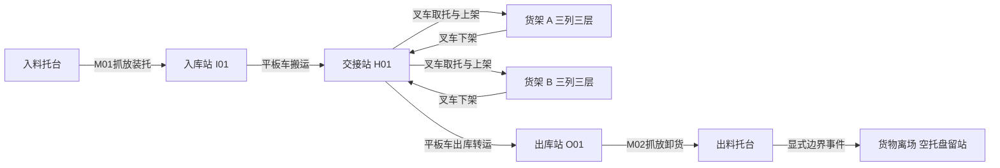
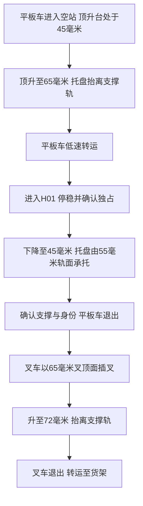
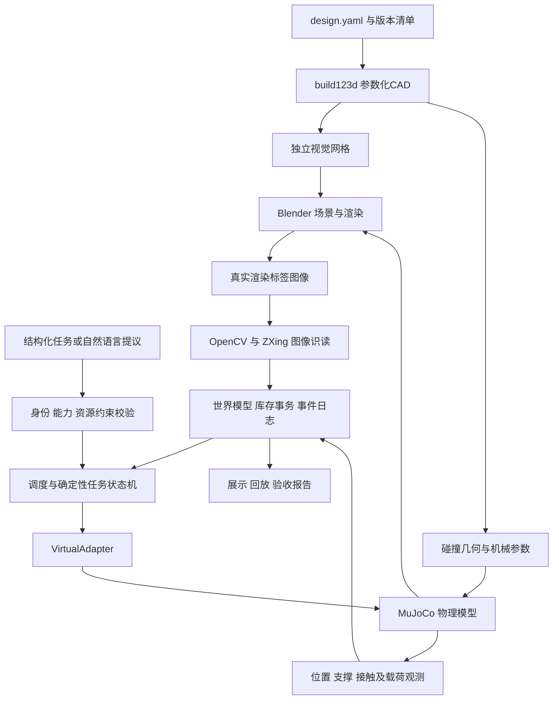

# 桌面 AGV 与机器人仓储 Demo 详细设计

版本 v2.0.0 · 状态 待实现 · 日期 2026-10-09 · 当前阶段 AGV 与机器人完整软件仿真

本设计的第一阶段必须实现平板顶升 AGV、移动叉车机器人及机械臂取放机器人，包含三维模型、关节与执行器、运动规划、模拟控制、图像感知、协作、库存事务和异常恢复。阶段边界是“不连接、不控制真实设备”；虚拟机器人本身及其完整控制闭环均属于必做内容。

默认配置为 R01 平板 AGV、F01 叉车、M01 入库机械臂和 M02 出库机械臂，共三类四台虚拟设备。两台机械臂复用同一六轴模型与平行夹爪，在两个固定工位实例化；数量和结构是本版设计选择，并非用户指定采购型号。第一阶段先分别验证叉车最高层取放和机械臂真实接触抓放，再集成装托→双车上架→下架→机械臂卸货闭环。

本文是供开发 Agent 执行的工程设计规格，面向软件仿真实现；机械与电控部分用于建立模拟约束及后续虚实迁移接口。采用参数化 CAD、物理仿真、图像扫码、确定性任务执行和库存事件闭环。所有尺寸、计算和验收指标均用于设计与试验准备；尚未取得实体测量或仿真运行结果，本文不能作为已验证的制造放行文件。

建议阅读顺序：第0章确认文档与实施范围，第17章了解工作包，第25章先读取机械臂、装卸与货物事务，再读第18至23章的通用接口、规划、动作、感知和试验规格，再查第3至8章的几何与物理依据。附录配置为示例子集；第13章BOM只属于后续实体参考。

来源是 ChatGPT 对话《设计桌面AGV Demo》中本次可读取的五轮记录。记录描述了 1800 × 1200 mm 桌面、双车型、三层 18 货位、80 × 60 mm 起始托盘、200 g 货物目标及 build123d、Blender、MuJoCo、OR-Tools 路线。它们是原对话方案，当前未见完整需求签署。原 HTML、MP4、CAD、代码和运行日志未取得，原助手关于演示文件已生成的描述按来源陈述保留，未据此认定工程功能已经实现。

## 0 Agent 执行合同

### 0.1 当前交付与第一阶段实现范围

本次聊天负责设计文档与自审，用户已明确“代码不需要你实现”。该约束只限定本次文档作者的工作，不能被执行 Agent 解读为第一阶段省略 AGV、叉车或机械臂实现。未来实施任务应按本规格交付可运行的完整虚拟设备系统。

|对象或能力|第一阶段必须实现|阶段边界|
|---|---|---|
|R01 平板 AGV|底盘、车轮、顶升台、差速导航、模拟控制与取放托盘|以物理执行器驱动，不用动画替代|
|F01 叉车机器人|底盘、门架、双叉、升降控制、18货位真实接触取放|包含最高层、互锁、稳定性与模拟失电|
|M01/M02 机械臂|六轴关节、夹爪、视觉定位、IK、轨迹、接触抓放、装托与卸货|必须有可运行的虚拟控制，不只展示模型|
|协作与业务|工位交接、预约、货物与托盘绑定、库存事务、异常恢复、回放|同一物理世界、同一仿真时钟|
|实体控制|仅保留未来适配接口和硬件参考|第一阶段不连接设备、不烧录固件、不发送实体命令|

参数化 CAD、MuJoCo 动力学、实际渲染图像识读、任务服务和展示均在第一阶段。机械结构与执行器参数服务于虚拟建模，不能因为尚无实体设备就删去。实体采购、制造、接线、固件、HardwareAdapter、H0/H1 实物验收属于后续阶段。

第一阶段默认以 MuJoCo CPU 白模完成闭环，Blender 用于视觉资产、图像试验和影片。4 分钟、1080p、中文字幕、静音影片消费通过验收的仿真轨迹；视频不能替代设备和协作验收。

### 0.2 设计初值的处理规则

- 用户当前指令和项目 AGENTS.md 优先于本文；原对话内容只作为方案来源。
- 无“已冻结”标识的尺寸、质量、时延、成功率和预算均为设计初值。Agent 可在纯软件阶段通过试验修订，并记录理由和影响；不得把初值写成实测性能。
- 编码前检查参数一致性。单独维护货架支撑面、托盘底面、叉孔上下边界和货叉顶面高度，不混用不同高度基准。
- 任何“成功”状态必须由观测确认。MuJoCo 真值可用于物理断言与测试答案；扫码结果必须来自实际渲染图像，不能从对象标签属性直接返回。
- 跨层更改要同步 CAD、碰撞体、MJCF、BOM 参考、测试和 design_version。保留已有冻结产物，不覆盖历史报告。
- 不臆造依赖兼容性、试验结果、采购价格或完整对话内容。无法完成的检查应给出失败证据及下一步恢复方案。
- 若项目 Python 3.10.14 无法使用所需依赖，先报告具体版本、平台和安装错误，再提交环境调整建议；未经决定不替换项目基线。

### 0.3 版本与报告口径

v1.1.0 与 v1.2.0 保留原双车设计及审查历史。v2.0.0 根据用户补充纳入机械臂，并更改货物/托盘数据语义，消息 schema 升至 2.0；旧消息和库存模型不直接兼容。本版进行三轮顺序自审，历史累计九轮。所有轮次均为文档审查，机器人仿真仍待未来执行 Agent 实现与验证。

实施完成报告记录 design_version、代码提交标识、锁定依赖与平台、试验配置、种子、各用例通过/失败数量、原始证据和未验证事项。界面、视频和报告明确标识“纯软件仿真”。文档作者本次未实现或运行这些机器人。

## 1 设计范围与证据边界

### 1.1 基线与补充设计

|类别|内容|本文处理|
|---|---|---|
|原对话方案|双车接力、上架与下架出库、扫码核验、库存更新和事件记录|纳入设计范围，逐项配置验收用例|
|原对话参数|1800 × 1200 mm；两组 × 三列 × 三层；80 × 60 mm 托盘；200 g 货物|作为暂定设计输入，不代表已冻结|
|原对话演示要求|4 分钟、1080p、中文字幕、静音；结尾软件框架及 BOM|保留为演示交付规范，演示时长独立于实际作业节拍|
|本次用户补充|第一阶段包含AGV、叉车等移动机器人及机械臂取放机器人，仅排除真实设备控制|作为范围要求；默认两台固定机械臂为设计选择|
|本次设计建议|叉孔与货叉配合、层高、车体尺寸、控制协议、互锁与误差预算|标为设计初值，由 CAD、仿真和实物试验确认|
|尚未验证|举升能力、稳定性、定位精度、扫码率、成功率、成本和依赖兼容性|不得在投资人材料中称为实测结果|

### 1.2 最小完整闭环

操作者下达“将产品 A 入库到第三层指定货位”。场景初始化为货物在入料托台、空托盘在 I01，两者尚未绑定。M01 根据图像身份与姿态抓起货物，放到托盘并确认承托，库存服务原子绑定货物与托盘并登记入库。机械臂退到收拢位后，R01 从 I01 取托并运到 H01；F01 取托、核验货位、第三层上架。出库按 F01→H01→R01→O01 执行；R01 退出后，M02 抓走货物放到出料托台，原子解绑，显式模拟离场事件再扣减货物数量。空托盘留在 O01。

第一阶段必须完成标准箱件自动装托和卸货。不要求自动装箱、多物体堆叠、混杂散件拣选、包装拆封或工业认证。标准箱件通过真实夹持与支撑接触运动；禁止在场景初始化时直接把货物固定到托盘绕过机械臂，禁止动作中创建隐藏刚性绑定。外部喂料/提货事件只用于任务边界，不能替代机器人取放。

### 1.3 三种运行模式

第一阶段实现物理闭环与历史回放两种模式。物理闭环由控制指令驱动 MuJoCo，显示“纯软件仿真”、试验条件和观测健康状态；历史回放只读取已记录轨迹，显示“仿真回放”、原始 run_id 和原始时间，不写当前任务或库存。概念脚本若没有物理证据，单独显示“概念演示”，不得计入验收。实体模式只保留未来接口定义，当前界面不可启用。

## 2 需求指标与验收口径

以下数值是 v2.0.0 的建议目标。验收必须同时记录模型版本、控制参数、载荷、标签规格和观测证据；没有报告的指标保持“待验证”。

|编号|设计指标|建议目标与条件|
|---|---|---|
|R01|仓储容量|18 个独立货位，每货位 1 个托盘；两组 × 三列 × 三层|
|R02|有效载荷|货物 ≤ 200 g，托盘目标 ≤ 50 g；取放按总载荷 250 g 验证|
|R03|高位取放|第三层托盘支撑面 z = 400 mm；货叉顶面需要到 417 mm，最大目标 450 mm|
|R04|低位运输|载货叉顶面 ≤ 70 mm；高于 100 mm 仅在货架对位区域慢速直进直退|
|R05|速度限制|普通移动 ≤ 0.10 m/s；载货转弯 ≤ 0.05 m/s；插叉 ≤ 0.01 m/s；高位接近 ≤ 0.005 m/s|
|R06|精对位|建议横向误差 ≤ 1.5 mm、航向误差 ≤ 0.5°；全局定位只负责到达接近区域|
|R07|举升定位|稳定后误差 ≤ 1 mm；取放前等待 ≥ 0.5 s 并确认位置不再漂移|
|R08|扫码|限定场景首次识读 ≥ 95%；最多 3 次读码后正确识别 ≥ 99%；错码放行数为 0|
|R09|库存一致性|同一托盘只允许一个已确认位置；重复事件不重复记账；不确定货位不得分配|
|R10|整套演示|固定脚本连续 20 轮完整入出库均无人工修复；单动作重复验证另见第 14 章|
|R11|停止保护|虚拟控制心跳 10 Hz，连续丢失 300 ms 后模拟控制器开始停止；停止距离从仿真轨迹计算，实体实测留待后续|
|R12|可追溯性|命令、图像、机器人状态、库存事件、错误码均关联 task_id 和版本号|
|R13|机械臂抓放|M01/M02均完成200g箱件的接触抓取、50mm抬离、搬运、释放和撤离；正常条件各50轮|
|R14|设备协作|装托→AGV→叉车→货架→叉车→AGV→卸货；机械臂与车辆互斥进入工位|
|R15|货物/托盘一致性|单货物单位置、单活动绑定；装卸原子提交；空托盘不计在库货物|

扫码指标的分母为预先登记的独立扫描试验，区分首次成功与重试成功；没有错误识别的试验数量也必须列出。20 轮零失败只满足演示准入目标，不足以声称工业可靠性或 99% 整体成功率。

## 3 桌面布局与空间坐标

### 3.1 全局坐标与区域定义

桌面左下角为世界坐标原点，X 向右、Y 向桌面上方、Z 向上，所有软件接口使用米、秒、千克、弧度。机械图纸使用毫米，导出时只在一个边界进行 mm → m 转换。机器人本体坐标 X 指向货叉或车辆前方，Y 向左。位姿四元数接口采用 xyzw，MuJoCo 输入采用 wxyz，适配器必须显式转换。

|区域|暂定世界坐标范围 mm|用途|
|---|---|---|
|桌面边界|X 0 至 1800；Y 0 至 1200|所有固定结构及运动包络均受此约束|
|货架 A|X 350 至 740；Y 940 至 1100|三列三层，入口朝向负 Y|
|货架 B|X 960 至 1350；Y 940 至 1100|三列三层，入口朝向负 Y|
|货架作业带|X 250 至 1450；Y 450 至 920|预留对位、插叉、退叉与转向包络|
|接力交接站 H01|中心 X 850；Y 350|平板车由负 Y 进入，叉车由正 Y 接近|
|入库站 I01|中心 X 250；Y 250|M01装托、扫码、平板车取托|
|出库站 O01|中心 X 1400；Y 250|平板车落托、M02卸货；空托盘留站|
|平板车停车点 P01|中心 X 650；Y 200；yaw=π/2|初始空载等待点，进入作业区前检查完整包络|
|叉车停车点 P02|前轮轴中心X1550；Y900；yaw=−π/2|朝−Y，车体后端Y1095、叉尖Y780；全部包络在工作区外；退出路线须扫掠验证|
|M01底座与入料托台|底座(150,470,0)；托台中心(150,150)，台面z=55|固定六轴机械臂，标准箱件入料|
|M02底座与出料托台|底座(1650,470,0)；托台中心(1650,150)，台面z=55|固定六轴机械臂，出库卸货|
|ARM-IN工作区|X80至520；Y80至700；Z0至650|M01执行时独占；与I01及相交车辆通道联合预约|
|ARM-OUT工作区|X1200至1720；Y80至700；Z0至650|M02执行时独占；与O01及相交车辆通道联合预约|



图为业务路径，真实几何坐标以本章区域表为准；路径与转向包络由碰撞模型计算。

货位按 A-L1-C1 至 B-L3-C3 编码。三列中心 X 分别为 A 415、545、675 mm 和 B 1025、1155、1285 mm；每位前沿统一为 Y = 940 mm，托盘入位后几何中心暂定 Y = 1000 mm。上述坐标是白模布局初值，尚未完成整车连续路径包络验证。

### 3.2 包络与通行策略

叉车底盘暂定 220 × 150 mm，以前轮轴线在桌面上的投影为本体原点。车体X边界为−195至25 mm、Y边界为±75 mm；货叉根部X=40 mm、端部X=120 mm。托盘充分取托时X范围为55至135 mm、几何中心X=95 mm，货叉有效插深为120−55=65 mm。空载总包络长315 mm，载货总长330 mm；固定车体前端与托盘近边之间留30 mm。把机器人外形、载荷伸出、定位不确定性和安全距离一起形成碰撞包络；不能仅按底盘中心规划。按前轮轴中心旋转，固定车体最远角点半径约209 mm，初始转向外接圆按直径430 mm预留。货架作业带因此调整为Y=450至920 mm。真实CAD扫掠若含凸出的门架、传感器或载荷，必须重新计算；预约覆盖机器人膨胀包络与区域的任何交叠。

桌边暂留 80 mm 静态退让距离。以 v = 0.10 m/s、失联检测 0.30 s、后续控制迟延 0.05 s、减速度 0.30 m/s² 为假设，停止距离约为 52 mm；80 mm 还需要覆盖定位误差和实测制动偏差。桌边围挡独立承担跌落保护。

首版只允许一台移动机器人进入货架作业带；交接站也实行独占预约。机械臂执行期间，其工作区和相交车辆通道一并锁定；收拢并确认STOW_CLEAR后才交给车辆。固定底座、收拢臂体和托台始终是导航障碍物。P01/P02已为新增工作区调整。P02不允许原地旋转，因为209mm转向半径会越过80mm桌边退让；先沿−Y驶出停车位，再按已验证的连续曲线路径进入通道。若规划无法找到完整可行退出路线，V0失败并修订停车位，不得删除桌边裕量。完整四设备路径仍须验证。每次规划需要预留完整空叉退出、带载退回和撤离路径，不能把托盘刚放好但机器人无法退出视为成功。

## 4 托盘 货架与交接站机械接口

### 4.1 托盘与货叉基准

|项目|设计初值 mm|定义|
|---|---|---|
|托盘外形|X 80 × Y 60 × Z 18|沿 X 方向插叉；尺寸包含底板与上板|
|叉孔|2 个，净宽 18、净高 8|横向中心 y = ±15；开孔 z = 4 至 12，沿 X 贯通|
|货叉|2 根，长 80、宽 10、厚 2.5|货叉中心距 30；有效插入长度暂定 65|
|货叉材料|不锈钢板，具体牌号待选|承载部分优先金属；打印件用于安装与导向|
|货物包络|X ≤ 70、Y ≤ 50、Z ≤ 80|标准试验箱60×40×50；真实支撑，不遮挡码|
|货位净空|宽 110、深 120、净高 ≥ 120|托盘外缘与结构之间留可测间隙|
|货架支撑面|z = 100、250、400|层间距 150；上方额外保留货物与抬升空间|
|货架整体|每组约 390 × 160 × 540|含立柱、基座与最高层顶部防护空间|

托盘下表面与货架支撑面重合时，叉孔顶部位于支撑面上方 12 mm。插叉时货叉顶面设置为支撑面上方 10 mm，先保留 2 mm 竖向间隙；举升至上方 17 mm，接触叉孔顶部后使托盘底面抬离支撑面 5 mm。第三层因此需要货叉顶面 z = 417 mm，不能只按 400 mm 检查行程。

横向单侧名义间隙为 (18 − 10) / 2 = 4 mm。建议分配给局部定位 1.5 mm、0.5° 航向在 65 mm 深度造成的约 0.57 mm 横偏、零件制造 0.5 mm、导轨与装配 0.5 mm，合计约 3.07 mm。余量约 0.93 mm，仍需在打印试件和实物误差分布下验证。

托盘结构必须形成真实贯通叉孔，不能用实心视觉网格代替。底板、顶板和纵向支撑条分别建模；固定站支撑两侧 y = ±27 mm、宽 6 mm 的底面区域，避免覆盖货叉进入空间。

### 4.2 共用交接站

交接站采用固定两侧托盘支撑轨和中间顶升窗口。轨面高度 55 mm，轨底暂定 45 mm；外侧支腿形成净宽至少 140 mm 的入口。平板车宽 110 mm、固定车体高度不超过 35 mm，低位顶升台面 45 mm、高位 65 mm，顶升台暂定 70 × 40 mm，位于支撑轨中间。



托盘主体仍为80×60×18 mm；新增3 mm高定位凸边的总Z包络为21 mm，凸边仅在顶面边缘，不改变叉孔及货物支撑面z=18 mm。凸边、货箱和夹爪的相容性按第25章检查，50 g托盘目标包含凸边。

截面要求：两侧固定轨承托托盘底面的 y = ±27 mm 区域；70 × 40 mm 顶升台在轨间运动；双叉中心 y = ±15 mm，进入托盘 z = 4 至 12 mm 的贯通通道。尺寸相容性通过 CAD 扫掠与 MuJoCo 接触试验确认。

平板车进入站内后顶升到 65 mm，把托盘抬离轨面；落托时下降到 45 mm，使托盘由 55 mm 轨面承托，确认载荷转移后车辆退出。叉车从相反方向以货叉顶面 65 mm 插叉，再升到 72 mm 取托。叉车落托时把叉顶面降至65 mm，轨面承托后让叉顶面与叉孔顶部留2 mm间隙，再退叉。取托后先直线退出站体，再把叉顶面从72 mm降至运输初值65 mm；在72 mm状态不得开始普通运输。由模拟独立占用观测确认托盘留在支撑轨上。

交接站边框、支腿和支撑轨必须同时通过平板车底盘、顶升台、叉车双叉的连续扫掠检查。结构需要机械定位挡块、可观察的托盘基准边和身份标签；两侧车均不得在另一台车未退出时进站。入库站、出库站复用相同接口，共 3 套站体。

## 5 叉车底盘 门架与承载校核

### 5.1 机械结构与运动限制

叉车采用双轮差速驱动、后部支撑轮、双导轨门架和丝杆升降。门架工作高度约 540 mm；货叉顶面目标范围 20 至 450 mm，对应有效行程 430 mm，门架安装零位必须计入行程换算。导轨承受前悬弯矩，丝杆承担轴向举升，禁止把丝杆当作唯一抗侧向构件。

建议使用两根小型直线导轨、一根约 500 mm 丝杆和独立升降位置编码器，顶部与底部各设置硬限位。初始导程按 2 mm，举升速度按 10 mm/s，则丝杆转速约 300 rpm。采购应校核该转速下输出转矩、导轨滑块间距、联轴器安装和轴承支撑，不能仅看静态保持转矩。

高位取放分为在远离货架时提升、低速沿货位轴线接近、落托、退叉和降低。取货顺序为先退出货架再下降到运输高度。货叉高于 100 mm 时禁止普通移动与原地转向；仅允许在预约的直线作业走廊内，以 ≤ 5 mm/s 完成必要的接近和退出。

### 5.2 静态前倾初算

以前轮接地线为倾覆轴，暂定固定车体质量 1.50 kg，其重心在轴后 50 mm；移动叉架质量 0.25 kg，重心在轴前 45 mm；托盘及货物质量 0.25 kg，重心在轴前 95 mm。固定车体包含底盘、电池、配重和固定门架，质量不能与移动叉架重复统计。


`M_resist = m_base × g × d_base = 1.50 × 9.81 × 0.050 = 0.736 N·m`


`M_tip = g × (0.25 × 0.045 + 0.25 × 0.095) = 0.343 N·m`


`SF_static = M_resist / M_tip = 2.14`


2.14 仅是上述假设下的静态结果。若载荷更靠前、配重更轻或固定门架使重心前移，应重算。设计目标暂定最不利静态力矩比 ≥ 2；动态试验还要加入加减速、轮子失去接触、偏载、桌面倾斜和高位微动。

前驱动轮接触中心暂定为(0, ±60) mm，后支撑轮暂定为(−160, ±55) mm，Z=0；后轮接触方式需在CAD与仿真中显式建模。横向稳定性以所有实际承重接触点的凸包为支撑多边形，要求合成重心投影留在内部。后支撑轮若不同时接地，不能按理想四角矩形计算。第一阶段从配置质量、重心和惯量计算模型重心与轮载，并监测轮地接触及边界距离；称重与实际轮载测量只属于后续实体阶段。

### 5.3 举升与货叉初算

移动质量暂按 0.50 kg、轴向设计载荷按 3 倍重力取 14.7 N。丝杆导程 2 mm、暂定效率 0.30，理想需求转矩约 0.0156 N·m。电机初选要求在 300 rpm 工作点可提供 ≥ 0.08 N·m 的有效输出，同时覆盖起动、导轨摩擦和效率偏差；此条件是采购筛选目标，并非已确认型号性能。


`T_screw = F × p / (2 × π × η)`


单根货叉按 65 mm 悬臂、宽 10 mm、厚 2.5 mm、E = 200 GPa、承担 250 g 总载荷的一半且按端部集中力简算，得到挠度约 0.043 mm、根部弯曲应力约 7.7 MPa。两倍载荷时对应约 0.086 mm 和 15.3 MPa。上述梁计算用于工程初筛。第一阶段刚体模型不能验证门架或连接件弹性变形，报告必须保留这一限制；材料允许应力、应力集中和支架总变形的实体或有限元验证留到后续阶段。

第一阶段为失电建立显式制动约束与制动失效两种模拟情形，记录载荷是否保持；不能默认冻结关节来声称防坠通过。后续实体升降机构需要可验证的防坠装置或保持制动，不能因采用丝杆就默认自锁；低位台架和高位实物失电试验留到实体阶段。

## 6 模拟执行器与后续电控约束

第一阶段把本章速度闭环、编码器、限位、载荷、心跳和电源状态实现为模拟设备或故障注入接口。下面的实体接线、电池和ESP32方案针对两移动机器人；机械臂模拟控制见25章，实体机械臂使用总成匹配控制器，均不在第一阶段连接。

### 6.1 平板车设计

平板车暂定 160 × 110 mm、固定车体含车轮包络高 ≤ 35 mm，双轮差速加支撑轮，轮径暂定 30 mm。中间顶升台为 70 × 40 mm、20 mm 行程，目标载荷 250 g。采用导向柱或滑轨约束倾斜，执行器推力初选 ≥ 15 N，设置上下限位和独立载荷存在检测。顶升机构及标签相机安装均应避开交接轨和叉车进入包络。

差速模型为 v = r(ω右 + ω左)/2，角速度 = r(ω右 − ω左)/b，其中 b 为实测轮距。两车独立标定轮径、轮距、左右电机极性、编码器比例、死区、滑移和制动距离。轮子安装尺寸相同也不能共享未经标定的控制参数。

### 6.2 控制层级与接口

主机运行规划、视觉和库存服务；每车一个 ESP32 类控制板运行运动控制、限位、急停状态和看门狗。控制板建议 100 Hz 速度或位置闭环，遥测 20 Hz，主机心跳 10 Hz。Wi-Fi 负责常规指令，调试保留 USB；无线链路不承担急停的唯一触发渠道。

|接口|每车需求|建议实现|
|---|---|---|
|驱动电机|2 路双向 PWM，2 路编码器|车端 PID、速度限幅、堵转或过流检测|
|升降电机|1 路，位置反馈，上下限位|叉车与平板车不同参数，均具备零位标定|
|急停输入|常闭回路及驱动切断状态|硬件断驱动，车端上报，不允许软件自动复位|
|载荷与接近|载荷存在、前向近距或保险杠|动作前置条件和碰撞停止|
|电源健康|电池电压，建议电流监测|低电量阻止新任务，失电保持载荷|
|维护接口|USB 串口、固件版本读取|仅在维护模式允许手动调试动作|

电控接线图需定义主电源、保险丝、驱动电源、逻辑稳压电源和共地。电机驱动的额定电流、堵转电流和散热能力由选定电机的数据手册决定；板上 PWM 电流额定值不能替代整个系统峰值电流核算。

### 6.3 电源预算与急停

暂定两车各使用一套带保护的 3S 电池系统，配合适配工作电压的电机驱动及独立 5 V/3.3 V 逻辑稳压。若容量按 2 Ah、名义电压 11.1 V、可用能量按 70% 估计，每车可用约 15.5 Wh；假设平均功率 15 W，则约 1.0 h。此为预算算例，最终用实测功率和电池放电曲线替换。

每车配置本地急停，另设桌面总急停。实体总急停通过专用硬件链路触发两车驱动切断，并联动机械臂控制器与夹爪停止/保持接口；具体电气方案由实体总成确定。原双车部分首版可使用独立低压线束，线束路径必须避开车辆运动区。急停后逻辑电源保留用于记录状态，升降机械制动保持载荷；人工确认环境安全、回零条件与库存观测后才能复位。

## 7 模拟定位 图像扫码与放置观测

### 7.1 两级定位

首版采用顶置相机识别车体标记，结合轮速里程计到达接近点；最终插叉依靠车载近距相机、货位或交接站标记及机械导向。OpenCV 支持标记检测和相机标定，可用于实现此路线 [S5][S6]。第一阶段通过渲染图像试验冻结标记字典、尺寸和帧率；后续样机另行验证。

相机需标定内参、畸变和相对桌面的外参。车体姿态标记尽量布置在固定低位平面，避免门架升降改变标记高度。单应矩阵只适用于选定平面；离开该平面的标记不能直接用同一平面变换计算精确位置，应使用已知尺寸和相机模型估计姿态。

主机每次控制使用带时间戳、置信度和坐标系的观测。关键定位或相机数据超过 200 ms 未更新时停止插叉；超过 500 ms 失去可靠定位时暂停普通行驶。数值是初值，需结合曝光、处理和通信时延验证。

### 7.2 身份码与扫码流程

产品码表示 SKU 或唯一产品实例；托盘码表示 PALLET_ID；货位码表示 SLOT_ID。相同 SKU 的不同托盘必须分别追踪。码内容采用白名单格式和校验字段，扫码文本只作为数据，不能解释为执行指令。托盘侧面码初值为15×15 mm，产品与货位码为25×25 mm，均含静区；定位标记另用40 mm ArUco。详细像素和贴标约束见第21章，禁止把顶置定位画面当近距二维码识读输入。

扫码时被扫描对象及对应机器人停稳，灯光固定，连续取得有效图像并保留原帧。每次独立扫描试验最多3次尝试，包括首次和最多2次重试；T07按200次独立试验计算时，首次成功至少190次，三次内成功至少198次。装托前验证独立货物身份与空托盘身份，装托后提交绑定；移动阶段再验证托盘及其绑定货物，最后核验目标货位身份。ZXing-C++ 提供条码识读能力，可接入图像帧而不是读取场景对象属性 [S4]。

虚拟扫码必须将 Blender 或仿真相机真实渲染的标签图像交给解码器。物体的隐藏 SKU 属性只用于试验答案对比，不进入感知输入。扫描失败时尝试重新曝光或轻微调整对位，最多三次；仍失败则保留托盘在原支撑面，进入待人工复核状态。

### 7.3 放置与占用确认

第一阶段稳定放置的初始判据为：正确托盘及货位身份；托盘水平位置误差≤2 mm、偏航误差≤0.5°、底面高度误差≤0.5 mm；目标支撑面承担的竖向载荷≥托盘与货物总重的90%，货叉承担≤10%；托盘速度≤1 mm/s、角速度≤1°/s，连续保持0.5 s。接触力先转换到世界坐标，并按作用于托盘或货物的受力方向沿Z累加；按正确geom所属物体过滤，不能把侧壁或邻位接触当作目标承托。这些阈值是待试验修订的设计目标。

上架由叉顶面h_s+17 mm开始降低，托盘底面到达支撑面后继续降到h_s+10 mm，令双叉与叉孔上壁脱离接触；第三层对应417→410 mm，H01对应72→65 mm。只有稳定承托判据成立才退叉；退叉后重新确认托盘位置与支撑，再提交最终位置。货叉退出距离须使叉尖完全越过托盘近边并留至少10 mm余量，不能只把动作计时结束当作已退出。

“已扫码”不能独立证明“已落托”。上架成功至少需要正确托盘码、正确货位码、位置与支撑关系观测、叉架卸载或等效载荷转移观测，以及货叉退出完成。仿真用接触、位姿和受力验证；实体用货位图像、站体传感器或载荷变化交叉确认。观测矛盾时货位进入 UNKNOWN，禁止继续分配。

## 8 CAD 物理仿真与视觉资产流水线

### 8.1 单一工程参数源

维护带版本的 design.yaml，定义尺寸、质量、重心、惯量、关节、物料 ID、货位坐标和传感器外参。build123d 生成可制造的参数化几何 [S1]；导出 STEP 用于工程交换，网格用于显示。Blender 与 MuJoCo 必须使用同一模型版本和稳定对象 ID。



模型属性中的身份真值只进入测试答案通道，不进入图像识读模块。后续 HardwareAdapter 保留协议设计，第一阶段不实现真实设备连接。

流水线产物包括机械 CAD、独立活动零件的视觉网格、简化碰撞体、MJCF 关节及执行器描述、物料清单和 manifest.json。manifest 记录 design_version、文件哈希、单位、导出程序版本、生成时间和输入参数哈希；缺少信息的资产不得作为冻结版模型。

### 8.2 视觉模型与碰撞模型

门架、托盘叉孔与货架采用多个基础几何或凸分解体组合，保留支撑面和真实空隙。MuJoCo 普通网格碰撞使用凸包几何，因此完整非凸托盘网格不能直接作为保留叉孔的碰撞体 [S2]。视觉细节可以精细，碰撞结构必须优先准确。

物理模型设置真实重力、自由托盘、轮轴关节、升降滑动关节、执行器限幅和轮地摩擦。动力学验证中不得把托盘永久绑定到货叉，也不得通过逐帧修改车体或托盘位姿掩盖控制、接触问题。Blender 则消费仿真位姿或回放已记录轨迹；其刚体系统可辅助视觉演示 [S7]。

### 8.3 仿真步长与同步

第一阶段使用run_id隔离一次运行，control_clock_domain固定为simulation。运动超时、虚拟心跳、观测新鲜度、资源租约、故障注入和稳定窗口全部使用同一sim_time_s；墙钟只用于计算性能、渲染耗时、进程超时及审计。不可把sim_time与UTC或不同进程的单调时钟直接相减。

用户暂停实时仿真时，统一暂停物理步进、虚拟控制器与控制计时，不因墙钟流逝触发虚假失联；恢复后继续同一sim_time。故障注入的“失联”必须在物理仍步进时停止通信，而不是暂停整个模拟器。历史回放不产生控制消息或业务写入。业务服务重启时物理模拟器可继续运行并由虚拟车端心跳检测停止；若模拟器本身崩溃且没有可信恢复快照，当前run标记ABORTED，不能只重置时间后续接为成功。

高质量Blender渲染在轨迹回放中离线执行。闭环感知使用已验证可在目标平台运行的MuJoCo相机渲染，或全系统暂停在一致物理快照上完成Blender拍摄；图像携带capture_sim_time、scene_version和frame_id。选择快照渲染时必须暂停所有虚拟控制计时，并记录实际墙钟耗时；这是非实时仿真，不得据此宣称实时性能。快速相机与离线影片必须复用同一标签内容及几何，渲染适配器能力在W01/W04验证 [S10]。

MuJoCo 初始步长建议 1 ms，并以 0.5 ms 重跑关键接触用例检查收敛。控制周期 10 ms、观测周期 50 ms、画面刷新 30 至 60 fps 独立配置。渲染速度不改变物理时间，事件含 sim_time 和 wall_time；暂停回放时明确显示暂停，不产生新的硬件动作。

摩擦系数 0.3、0.5、0.8 作为敏感性扫描初值，不能直接称为实物材料参数。还需扫描载荷 0、125、250 g，横向偏差 ±3 mm、航向偏差 ±1°、载荷偏心 ±10 mm。几何干涉检查要求无实体重叠；动力学采用软接触，不能把任意负接触间距都视为失败 [S2]。第一阶段拟定最大接触穿透≤0.5 mm，超限持续超过20 ms或出现非预期实体相交时判失败。求解发散、接触力非有限、支撑丢失和持续驱动饱和按用例记录。

1 ms与0.5 ms步长对照要求关键动作的成功/失败分类一致，稳定托盘位姿差≤1 mm、静稳支撑力均值差≤5%；瞬态冲击另记录峰值及变化，不据此声称结构安全。门架弹性和材料失效不在刚体模拟的可验证范围。

偏差扫描分为额定包络与压力测试：满足R06及制造误差预算的情况要求正常完成；±3 mm、±1°等超出插叉间隙预算的情形允许被阻止或进入受控失败，必须不碰撞后仍宣称成功。平均成功率不得把被阻止的压力测试混入额定场景分母。

## 9 软件框架与部署设计

### 9.1 首版组件选择

以下均为拟采用组件；目前没有取得可运行项目或锁定依赖，不认定为已实现。库版本必须在目标平台完成安装、导入和最小功能验证后锁定，不能依据最新文档直接写入冻结清单。

|模块|拟采用框架|责任及接口|
|---|---|---|
|参数化机械|build123d|读取参数，输出 STEP、显示网格及机械物料 ID [S1]|
|动力学|MuJoCo CPU与Python接口|车辆、机械臂、夹爪、自由箱件的动力学与接触 [S2]|
|机械臂规划与控制|MuJoCo运动学/雅可比加确定性IK和受限轨迹模块|关节链、收拢、TCP规划、转矩闭环及真实夹持；算法待实现 [S15]|
|场景与影片|Blender|资产、材质、相机、渲染与视频镜头；不作为库存权威 [S7]|
|视觉|OpenCV 与 ZXing-C++|标定、标记定位、产品与货位图像解码 [S4][S5][S6]|
|服务与数据|Python 3.10.14、Pydantic、FastAPI、SQLite|建议技术栈；接口校验、状态查询、事务和事件日志|
|优化|OR-Tools CP-SAT|能力与资源约束下的任务分配和站点预约 [S3]|
|任务执行|显式状态机与确定性控制器|检查前置条件、动作超时、观测确认和恢复|
|自然语言|可替换模型提供方 SDK|只生成结构化任务提议，不能直连电机|
|后续控制固件|ESP-IDF 与 C/C++|未来实体参考，第一阶段用模拟控制器表达编码器、限位与看门狗 [S8]|
|展示界面|TypeScript 网页与 WebSocket|任务、模型、库存、证据时间和告警；3D 库后续选型|

机械臂首版复用MuJoCo关节链、雅可比、反馈控制与接触模型，运动规划按第25章；不新增ROS 2或MoveIt硬依赖。

首版本体以明确实体、关系和 Pydantic 约束表达，不强制引入独立图数据库或 OWL 服务。ROS 2、Gazebo、多机消息总线及专用 Agent 编排框架作为后续选项，在迁移需求出现后评估，避免首轮闭环依赖过多系统。

### 9.2 Python 兼容性与部署边界

按项目规范使用 pyenv Python 3.10.14 和 venv，服务依赖由 requirements.txt 或 pyproject.toml 管理。Blender 通过它自身的 Python 环境或外部进程通信，不能假定使用服务 venv。CAD、仿真、服务各自拥有可追踪依赖环境，通过文件、JSON 和本地服务接口交换数据。

核对时 build123d 的 dev 分支声明 requires-python >= 3.11 且 < 3.15 [S9]。因此默认先寻找并验证支持 3.10.14 的稳定版本及其 OCP 依赖；冻结前必须完成 CAD 导出与关节模型烟雾试验。若无法满足功能与平台要求，再由负责人决定是否单独提升 CAD 环境版本，不能默默替换项目 Python 基线。

实体控制主机不承载离线高质量影片渲染。MuJoCo 或影片任务与实体任务隔离，启动硬件模式需要明确连接真实机器人、匹配固件和确认场地状态。录制轨迹不可重发为硬件命令。

## 10 本体 数据与库存事务

### 10.1 核心实体与关系

|实体|关键字段|必须保持的约束|
|---|---|---|
|Product|sku、product_id、尺寸、质量|质量与包络不超过承载能力；身份来源可追溯|
|Pallet|pallet_id、cargo_state、tare_mass、location|只有一个已确认位置或UNKNOWN；待确认物理转移单独记录，不产生重复托盘|
|Slot|slot_id、pose、capacity、occupancy、reservation_id|occupancy为EMPTY/OCCUPIED/UNKNOWN；预约单独记录，可预约已占用货位进行出库|
|Robot|robot_id、robot_class、capabilities、pose、health|R01/F01/M01/M02分设备校验；机械臂增加joint_state和tool_state|
|GoodsUnit|goods_id、sku、mass_kg、location、lifecycle|独立箱件身份；生命周期与托盘状态分开|
|PalletCargoBinding|goods_id、pallet_id、binding_version、state|同一货物与同一托盘最多一个活动绑定，装卸原子提交|
|Station|station_id、occupancy、reservation|交接窗口同一时刻只允许一个机器人|
|Task|task_id、意图、步骤、status|每步有前置条件、超时和预期观测|
|Observation|source、time、frame_id、value|置信度及新鲜度合格才能提交业务状态|
|Event|event_id、task_id、seq、payload|事件幂等、可回放；不直接推断未观测事实|

位置采用类型化引用，例如 SLOT:A-L3-C2、STATION:H01、ROBOT:F01、UNKNOWN。库存的确认位置与运输预约分开存储，预约不等于实际搬运。移动机器人阶段按整托运输，货物库存按goods_id去重计数；托盘位置另行统计。装托、卸货由机械臂真实接触完成并通过事务更新绑定；仅喂料与最终离场使用显式边界事件，不能直接修改数据库。

### 10.2 提交与故障恢复

规划时只预约目标货位和资源，不立即移库存。取托观测成立后，在单一数据库事务中把源位置标为已离开、托盘位置设为机器人；放托、退叉和目标确认全部成立后，再把机器人载荷清空并把目标位置设为占用。采用 event_id 唯一约束和实体版本检查避免重复回写。

一条移位事务至少关联 pallet_id、from_location、to_location、task_id 和证据集。如果物理动作已完成但主机在提交前崩溃，恢复后先重放日志并重新观测源、机器人、目标，不能自动重做搬运。观测仍不明确时，锁定涉及资源并进入 NEEDS_REVIEW。第一阶段允许操作者查看仿真证据后显式确认或重置整次试验；自动恢复用例不能通过这种人工确认计为自动成功。实体阶段对应现场盘点。

预约过期不代表站体空闲。每个占用资源含持有者、租约和实际占用观测；失联或租约过期后进入恢复态，只有可靠观测证明资源空闲才能重新分配。实体位置未知时保留库存计数和任务关联，不为了让界面整齐而将货物直接删除。

### 10.3 转移中间态与库存口径

托盘取放处于TRANSFER_PENDING时，记录源、目标、机器人、最近确认位置与证据，锁住两侧资源，不创建第二份库存。装卸货另建GoodsTransfer，携带goods_id、from_location、to_location、绑定版本和证据。两者不能共用含义不清的“载荷转移成功”。

货物生命周期为INBOUND→IN_WAREHOUSE→OUTBOUND_PENDING→OFFSITE。初始化货物在FEED:I-TRAY时不计在库；M01放货、松爪、撤离后，确认货物由PAL承托，原子创建活动绑定并登记入库，计数+1。移动机器人和货位之间的位置转移不改变计数；O01卸货后货物在FEED:O-TRAY，状态OUTBOUND_PENDING仍计数。显式GoodsExitConfirmed事件且出料托台身份一致时才OFFSITE、计数−1。

托盘承载状态为EMPTY、LOADED、TRANSFER_PENDING、UNKNOWN，托盘资产留在现场，不因货物离场自动变OFFSITE。M02卸货后PAL为EMPTY且留在O01，货物与托盘的活动绑定关闭。需要把托盘也移走时另立独立资产边界事件，不能复用货物离场事件。

已绑定货物的有效位置为PALLET:pallet_id，其世界位姿来自物理观测；托盘业务位置可能是ROBOT:R01/F01、STATION或SLOT。夹爪接管后货物位置为GRIPPER:M01/M02，源绑定按事务关闭，不伪记仍在PALLET。UNKNOWN不删除计数；OUTBOUND_PENDING在工位、夹爪和出料托台之间移动仍计数。第25.5章定义装卸提交和故障恢复细节。

货位占用、在库货物数、现场托盘数和载货机器人数量分别统计，不允许UI只显示一个混合“库存数”。机器人未完全退出前保持源区预约，租约超时不直接释放实际占用。

### 10.4 数据存储

SQLite 暂用于单主机首版，核心表为 pallets、products、slots、robots、stations、tasks、observations、events、reservations。保存事务日志和版本化快照；图像以文件保存，其哈希和路径写入 observation。记录统一单调时钟用于控制超时，UTC 时间用于审计；界面按 Asia/Shanghai 展示。

## 11 Agent 调度与机器人控制接口

### 11.1 自然语言与确定性执行

模型只把自然语言转换为任务提议，例如 action = STORE、sku = DEMO-A、quantity = 1、target_slot = A-L3-C2。服务校验 SKU、数量、库存、货位身份、尺寸、重量、机器人能力和系统状态。歧义或找不到库存时返回待补充信息，不能猜货位或伪造库存。

校验通过后由确定性规划器生成步骤，OR-Tools 可用于资源调度 [S3]。首版固定分工：M01装托、R01平面转运、F01货架取放、M02卸货；先做安全可执行的固定流程，再优化时间。求解超时或无解时暂停或使用经过验证的顺序计划，界面显示优化状态。

调度图节点为站点、货架接近点、停车点，边包含方向、包络、速度和通行时间。预约约束涵盖机器人、货位、站体与通道；等待不能占住另一台车必须退出的区域。死锁检测后释放未进入的预约，涉及实物占用的资源保持锁定。

### 11.2 动作合同

|动作|输入|前置条件与成功观测|
|---|---|---|
|move_to|robot、pose、速度上限|定位健康；低位运输；终点误差满足接近点要求|
|dock_linear|带正负号的本体X方向位移、载荷模式、速度|站体与通道预约有效；已对齐；禁止转向；高位≤5毫米每秒；全扫掠包络无非预期接触|
|align|robot、target_marker|身份匹配；精对位误差和数据时效满足要求|
|insert_forks|深度、速度、pallet|叉高处于叉孔窗口；路径净空；无超载和碰撞|
|lift_to|货叉顶面高度、速度|限位正常；载荷在能力内；稳定后达到位置目标|
|lower_until_supported|支撑面、预期对象|位置、支撑和卸载证据一致；不把电机停止当成功|
|withdraw_forks|空叉退出距离、速度|托盘已由目标承托且货叉已卸载；退出后托盘仍留在目标|
|retreat_loaded|带载直退距离、速度|托盘由货叉承托、源面已卸载；退出后载荷稳定并越过源结构净空|
|platform_lift|台面高度|站体独占；上下限位和载荷反馈合格|
|arm_move_joints|6个关节目标、joint_names、速度/加速度约束|IK或已验证收拢轨迹、关节限位和扫掠检查通过；反馈达标|
|arm_move_tcp|具名TCP位姿、path_kind、目标实体|按第25章求解IK并执行轨迹；直线段不能退化为关节直线|
|gripper_close|goods_id、目标间距、每指力上限|双侧接触、身份与夹持稳定；单凭闭合宽度不算取货|
|gripper_open|目标间距、support_id|目标已承托、货物稳定；开爪后货物留在目标|
|arm_stow|具名已验证收拢轨迹|不夹持货物；到位且STOW_CLEAR观测成立|
|stop|原因与等级|虚拟设备停止反馈；夹持或升降保持需显式模型，失效可检测|

每个动作携带run_id、command_id、task_id、robot_id、timeout_s、expected_state_version和schema_version。timeout_s从模拟控制器接受动作的sim_time开始计算，内部可生成expires_at_sim_s；客户端不再同时提供含义冲突的deadline字段。响应区分 ACCEPTED、RUNNING、SUCCEEDED、FAILED、UNKNOWN；ACK 只代表收到并接受，不等于物理成功。相同(run_id, robot_id, command_id)的请求与相同payload只能返回原动作状态，不得重触发执行；同一键若payload不一致，返回IDEMPOTENCY_CONFLICT。状态版本是机器人语义控制版本，在接受动作、终止动作、健康或模式改变时递增，不随每帧位置遥测递增；观测另带sample_seq。附录事件的entity_version是托盘业务版本，与机器人控制版本不共用。

命令接受记录先持久化再返回ACCEPTED，发送端使用事务outbox保存待发送消息；重启后根据幂等键查询虚拟控制器已接受的动作。无法查询到可靠终态时设UNKNOWN并停止、重新观测，不盲目再执行。终态SUCCEEDED/FAILED不可改写；补救动作使用新command_id并关联原失败动作。


### 11.3 虚拟与硬件适配器

VirtualAdapter按robot_class分派到FlatAgvController、ForkliftController、ManipulatorController和GripperController，把动作转换为MuJoCo执行器目标并返回模拟观测；后续 HardwareAdapter 的设计职责是转换为车端速度、位置与互锁请求并返回真实传感器；第一阶段不实现该适配器。适配器共享消息结构，但各自校准参数、误差和时延。业务层不能通过专用“动画已结束”路径跳过观测确认。

## 12 作业状态机 异常与演示脚本

### 12.1 入库与出库顺序

动作区分：取托后的撤离使用retreat_loaded，保持托盘在叉上；放托后的撤离使用withdraw_forks，保持托盘在目标支撑面。两者前置条件相反，不能以同一个“退叉”完成信号代替。带载高位撤离后才降低到运输高度，源区域在全部包络退出前保持预约。

入库状态机为 CREATED→IDENTITIES_VERIFIED→RESERVED→ARM_IN_PICKED→CARGO_SUPPORTED→CARGO_BOUND→ARM_IN_STOWED→FLAT_PICKED→HANDOFF_SUPPORTED→FORKLIFT_PICKED→TARGET_VERIFIED→PLACED→FORKS_WITHDRAWN→INVENTORY_COMMITTED→DONE。IDENTITIES_VERIFIED只核对入料货物与空托盘，不计库存；CARGO_BOUND在放货、开爪、撤离与承托确认后原子登记货物，不能重复加数。

M01按第25章装托并退出工作区后，预约服务把I01进入锁交给R01；R01顶升、退出并到H01，落托且完全退出后再交给F01。叉车货架取放沿用第20章，每次已确认位置变化各自提交事务，最终INVENTORY_COMMITTED表示业务任务完成，而不是才第一次记账。

出库状态机为 CREATED→RESERVED→SOURCE_VERIFIED→FORKLIFT_PICKED→HANDOFF_SUPPORTED→FLAT_PICKED→OUTBOUND_SUPPORTED→FLAT_EXITED→ARM_OUT_PICKED_AND_UNBOUND→OUTPUT_SUPPORTED→OUTPUT_RELEASE_CONFIRMED→ARM_OUT_STOWED→AWAITING_EXIT→DONE。OUTBOUND_SUPPORTED将货物生命周期记为OUTBOUND_PENDING；ARM_OUT_PICKED_AND_UNBOUND时M02已接管夹持，原子关闭PAL绑定并记录GRIPPER位置；OUTPUT_RELEASE_CONFIRMED在出料托台承托、开爪及撤离后确认卸货结果。只有GoodsExitConfirmed把货物变为OFFSITE并使任务DONE；等待外部离场事件时不是机器人故障。

各取放动作以观测确认物理位置，支持夹持、承托和提交之间的中间态。状态机必须使用第25.5章的提交边界：卸货抬离确认时关闭旧绑定，出料释放确认时仅移货物位置，不重复解绑或减库存。

### 12.2 异常处置

本表的人工复核、扶稳和复位均为后续实体处置参考。当前阶段对应 NEEDS_REVIEW、显式模拟复位或有记录的场景重置；不实施实物操作，且场景重置会终止当前验收轮，不能抹除失败。

|异常|自动动作|恢复要求|
|---|---|---|
|产品码或货位码不符|停止任务，不举升或继续入位|正确身份复核后重新规划；保留拦截图像|
|读码失败|停止并重试，最多三次|仍失败则人工复核，保留当前支撑状态|
|定位过期或对位超差|停止当前运动|重新定位和核验，不盲目退叉|
|插叉碰撞或升降堵转|停止并保持载荷|确认叉孔、支撑关系和安全退出路径|
|托盘滑移或落托不确定|锁定源、目标及机器人|重新观测或人工扶稳，库存标 UNKNOWN|
|无线失联|车端看门狗停止|重连后查询旧命令与观测，禁止自动重复执行|
|低电量|不接新任务，评估当前安全支撑点|受控卸载或人工介入；不高位长途返回|
|急停或断电|切运动驱动，机械保持升降|人工复位，检查实物并重建可信状态|

动作超时按路径或行程与速度上限生成：timeout_s ≥ 距离/有效运动速度 + 加减速时间 + 稳定观测时间 + 通信余量。初始示例：定位接近30 s，扫码5 s，精对位10 s，高位65 mm插叉在5 mm/s下至少13 s，超时初值取20 s；全行程430 mm举升在10 mm/s下至少43 s，超时初值取60 s；落托稳定观测5 s。第三层按10 mm标称净空推导的最小空叉退出为95 mm、带载退出为110 mm；默认再加10 mm鲁棒余量，分别执行105和120 mm，超时初值30和35 s。H01同样采用默认空叉85 mm、带载100 mm。第20章给出推导，所有下降均先确认活动几何脱离固定结构。生成器遇到更长路径必须增加时限，FAILED和UNKNOWN均不推进下一步；超时不等于已停止，必须主动停止并确认。

### 12.3 四分钟影片规范

|时间段|镜头与字幕内容|
|---|---|
|0 至 25 s|系统全景、AGV/叉车/机械臂三类四设备、18货位；持续标明纯软件仿真|
|25 至 95 s|图像核验、M01接触抓放装托、AGV转运、H01交接、叉车第三层上架；字幕对应实际事件|
|95 至 140 s|叉车下架、AGV转运、M02卸货；展示货物与托盘位置变化|
|140 至 170 s|错码拦截与恢复；展示原因、观测证据及未被错误提交的库存|
|170 至 205 s|参数化 CAD、MuJoCo 接触和世界模型架构；区分已实现与拟采用|
|205 至 240 s|软件框架和分组 BOM；标示预选规格及待验证参数|

输出 1920 × 1080、4 分钟、中文字幕、无配音、无音轨或全静音。若压缩实际动作时间，注明加速倍率。完整 BOM 放在文档中，影片只展示可读摘要；成功率、吞吐和成本只能引用真实试验或明确标记的预算。本文不重制原影片。

## 13 后续实体阶段 BOM 参考

本章不属于第一阶段采购任务。第一阶段硬件采购预算为 0；若使用收费模型或云算力，其费用另行批准。默认在已有电脑上使用本地仿真和可替换的模型适配器。

本 BOM 是一套实体样机的功能采购清单。原双车子清单数量涵盖一台平板车、一台叉车、两组货架和3个站体；v2.0新增机械臂与夹爪的补充BOM见25.8。额定规格仍需由 CAD、负载测试和供应商数据手册确认。金额为人民币工程预留区间，未询价，不是现价或供应商报价。BOM 编号与 CAD 物料 ID 对应。

### 13.1 机械 BOM

|编号|物料与数量|预选规格或采购条件|预留金额 元|
|---|---|---|---|
|M01|桌面底板及围挡 1 套|1800 × 1200；刚度、平整度与桌边跌落防护|500 至 1000|
|M02|三层货架 2 组|每组约 390 × 160 × 540；3 列；支撑面 100/250/400|400 至 800|
|M03|托盘 24 个|主体80×60×18，总高21含凸边；双贯通叉孔；18 在库加 6 周转|120 至 240|
|M04|入库 交接 出库站 3 套|轨面 55；平板车通行净宽 ≥ 140；相反侧插叉|240 至 450|
|M05|平板车底盘与顶升台 1 套|160 × 110；车体高 ≤ 35；台面 45 至 65|200 至 400|
|M06|叉车底盘 门架框 配重 1 套|底盘 220 × 150；门架约 540；质量与重心可调|350 至 700|
|M07|轮组与支撑轮 2 套|平板轮径约 30；叉车约 50；轮材和负载待验|120 至 240|
|M08|叉车直线导轨 2 根|有效行程 ≥ 430；轴向长度及滑块间距由 CAD 确认|240 至 500|
|M09|丝杆 轴承座 联轴器 1 套|导程约 2；长度约 500；抗弯与转速校核|180 至 350|
|M10|金属双货叉与安装架 1 套|2 根 80 × 10 × 2.5；中心距 30；有效插深 65|80 至 180|
|M11|升降防坠或保持制动 1 套|失电保持 ≥ 250 g 载荷及移动架重量|120 至 300|
|M12|平板顶升导向件 1 套|20 mm 行程；与中心台及固定轨面相容|100 至 220|
|M13|紧固件 打印件 线槽 1 批|含备件；承载固定点不能只靠薄壁打印件|200 至 400|

机械小计为 2850 至 5780 元。采购前必须先完成托盘、货叉与单站体试件，验证互相兼容；丝杆、导轨和电机安装尺寸确认后再采购整车材料。

### 13.2 感知 控制与供电 BOM

|编号|物料与数量|预选规格或采购条件|预留金额 元|
|---|---|---|---|
|E01|带编码器行驶电机 4 个|两车各 2；工作速度、堵转电流和安装轴型匹配|240 至 480|
|E02|叉车升降电机与驱动 1 套|在约 300 rpm 提供目标 ≥ 0.08 N·m；有位置反馈|180 至 400|
|E03|平板顶升执行器与驱动 1 套|20 mm 行程；目标推力 ≥ 15 N；位置或限位反馈|120 至 280|
|E04|ESP32 类控制板 2 块|足够 GPIO、编码器计数、PWM、Wi-Fi 和维护接口|80 至 160|
|E05|双路行驶电机驱动 2 块|额定与峰值电流覆盖选定电机；支持停止与使能|100 至 220|
|E06|升降位置反馈 2 套|叉车与平板各 1；分辨率支持 ≤ 1 mm 定位|100 至 240|
|E07|上下限位开关 4 个|两车各 2；可独立于普通位置传感器停止越界|40 至 100|
|E08|急停 开关 驱动切断线束 1 批|本地 2 个加总急停 1 个；机械保持独立验证|180 至 350|
|E09|带保护电池 2 套|暂定 3S 约 2 Ah；输出与整车峰值电流相容|240 至 480|
|E10|匹配充电器 2 个|与电池体系和保护方案匹配；有人值守充电|100 至 220|
|E11|DC-DC 保险 电源监测 2 套|逻辑电源隔离波动；保险、导线与峰值负载匹配|120 至 260|
|E12|顶置定位相机 1 套|视野覆盖 1800 × 1200；固定架；曝光及帧率可控|300 至 700|
|E13|固定扫码相机 2 套|入库与出库各 1；近距对焦；可采集原图|240 至 500|
|E14|叉车近距相机 1 套|托盘与货位标记同视场；满足精对位误差目标|180 至 400|
|E15|站体及叉架载荷检测 5 组|3 站加 2 车；光电或称重方案随结构定型|100 至 250|
|E16|前向接近或保险杠 2 套|每车 1；响应时延支持最低接近速度保护|80 至 200|
|E17|标签 灯光 相机支架 1 批|码制静区、照明、标定板和外参固定|120 至 300|
|E18|主机与网络 1 套|复用现有电脑和网络；隔离实体控制与影片渲染|0 复用|

电控与感知小计为 2520 至 5540 元。原双车子系统直接材料总预留为 5370 至 11320 元，加约 20% 备件及试错预留后约 6500 至 13600 元。预算不含新电脑、加工外包、运费税费、开发工时或模型 API 使用费；没有已发生采购或报价依据。

## 14 第一阶段仿真验证与后续实物验收

### 14.1 分层准入

|层级|通过条件|产出|
|---|---|---|
|V0 几何|托盘叉孔、交接站、机械臂抓放与第三层取放无干涉；18位可达|参数化 CAD、扫掠报告、尺寸检查记录|
|V1 场景|完整四设备场景、真实图像扫码、稳定对象 ID、回放轨迹|场景资产、扫码图像集、演示事件日志|
|V2 动力学|真实接触取放、载荷、制动、稳定性和步长检查通过|MJCF、配置、视频、数值结果与失败样例|
|V3 业务|入出库、错误拦截、重试、失联、重启和库存一致性通过|服务代码、接口契约、任务日志与数据库快照|
|H0 台架|电控急停、上下限位、失电保持和机械承载通过|接线图、固件、台架测量记录|
|H1 实体|18位取放、两车与两臂完整流程满足目标；新增实体工期另估|校准参数、实体图像、验收报告与差异清单|

V0 可先完成场景与几何，再补 V2 动力学；不得用 V1 影片替代 V2 报告。实体完整采购与高位联调在关键接口和承载验证通过后进行。

### 14.2 核心验收用例

第一阶段执行T01至T09、T11至T16；T13至T16见第25.7章。T10 在当前阶段只验证模拟急停、失联停止、驱动限位和模拟保持机构；真实制动距离与高位失电台架试验留到 H0/H1。T02 的定位误差、T05 的稳定性和 T07 的识读率均为仿真环境下的结果。

|用例|条件与数量|判定标准|
|---|---|---|
|T01 插叉配合|单托盘；额定误差边界与超界压力测试分组|额定范围正常完成；超界可受控拒绝；不得卡死、推走托盘或虚假成功|
|T02 全行程升降|0、125、250 g 各 10 次|位置误差 ≤ 1 mm；无撞限位、明显漂移和堵转|
|T03 第三层真实取放|总载荷 250 g，单货位 100 次|成功 100/100；无跌落、碰撞及虚假完成；记录失败即重新整改|
|T04 全货位可达|18位×5轮×每轮上架和下架2次=180次|每个货位完成往返取放并撤离，路径无干涉|
|T05 稳定性|偏心 ±10 mm，摩擦扫描及最差重心|静态目标 ≥ 2；动态不倾覆，载荷不滑落|
|T06 双车交接|H01 满载接力 50 次|站内无双车重叠；支撑明确；身份与位置一致|
|T07 图像扫码|登记角度 光照 遮挡组合共 ≥ 200 次|按 R08 分开统计首次与重试；保留原图和答案|
|T08 错误拦截|错产品 错托盘 错货位各 20 次|60 次均不放行，库存不错误提交|
|T09 网络与服务故障|取托中 落托后 提交前注入故障各 5 次|无重复动作和记账；可重新观测恢复或进入 UNKNOWN|
|T10 模拟急停与失电|低位和第三层分别注入停止、驱动失电与制动失效|模拟响应与停止距离有轨迹；正常制动保持，制动失效被检测并记为失败；实体试验留待H0/H1|
|T11 库存回放|重复 乱序 缺失事件及快照恢复|重复幂等；乱序可检测；缺失不得伪造成功|
|T12 完整演示|同一冻结版本连续20轮|每轮M01装托、R01/F01上架下架、M02卸货及货物离场；错码支线正确拒绝，画面与库存一致|

T03 的 100 次零失败是首版筛选目标，不足以证明 99% 可靠性达到给定置信度。每轮成功必须满足动作和库存两方面；失败分为几何、动力学、视觉、通信、业务五类，报告条件和观测，不删除失败样本。

### 14.3 需求与验收映射

|需求|主要验收|必要证据|
|---|---|---|
|R01 容量|T04|18货位清单与180次操作记录|
|R02 载荷|T02 T03 T05|配置总载荷、姿态与接触力|
|R03 高位取放|T03 T04|417毫米叉高轨迹及目标承托证据|
|R04 低位运输|T06 T12|高度互锁与普通运输速度轨迹|
|R05 速度|T01 T05 T06|普通、插叉、高位接近的速度和加速度记录|
|R06 精对位|T01 T04|真值对照误差、感知输入和受控拒绝记录|
|R07 举升定位|T02 T03|位置误差及0.5秒稳定窗口|
|R08 扫码|T07 T08|独立试验ID、原帧、真值与解码输出|
|R09 库存|T06 T09 T11|位置唯一性、生命周期计数及事务版本|
|R10 完整演示|T12|同一版本20轮的完整日志和失败记录|
|R11 停止保护|T09 T10|同一仿真时间域内心跳过期与停止轨迹|
|R12 追溯|全部用例|run_id、task_id、命令、事件、模型与代码版本|
|R13 抓放|T13 T14|两机械臂关节/TCP/夹持/货物支撑轨迹|
|R14 协作|T12 T15|机械臂与车辆互斥和进入锁交接|
|R15 绑定|T11 T16|goods_id位置、绑定版本、空托盘与货物计数|

T12每轮包含正常入出库主流程与错码拦截支线。主流程要求自动完成；支线预期结果是停止并保留正确库存，不要求错误输入也继续完成搬运。自动重试恢复只在试验预先规定的遮挡解除或通信恢复后判定；人工确认、改库或场景重置均终止本轮，不算20轮自动成功。正例、预期拒绝和受控故障各自统计，报告不能合并成一个含义不明的成功率。

### 14.4 自动检查与人工检查

第一阶段自动检查包括单位与轴向、货位计数和唯一性、叉孔碰撞几何、动作合同、资源独占、版本一致性、库存不变量和渲染图像可读性。人工检查限于查看模型、轨迹和报告。连接松动、尖边、围挡、线束和电源热状态只列入后续实体检查。本文审查不等于已执行机器人仿真或实体试验。

## 15 第一阶段开发顺序与工程交付

### 15.1 阶段计划

P0 至 P5 都属于第一阶段纯软件模拟。P6 属于后续实体阶段，不在当前范围。

工期为具备相关经验人员的初步工作量估计，不是承诺。若以单人实施，阶段顺序执行；加工和采购等待另外计入。

|阶段|建议工作量|必须完成的结果|
|---|---|---|
|P0 需求与环境|1 至 2 人日|确认载荷与接口；验证 Python 3.10.14 依赖可用性；建立版本清单|
|P1 设备与工位CAD|5至8人日|托盘、双叉、门架、六轴机械臂、夹爪与工位；连续扫掠与IK可达验证|
|P2 独立设备动力学|7至12人日|叉车最高层取放与机械臂接触抓放；车辆稳定性、夹持摩擦与步长复验|
|P3 全场景与视觉|4至7人日|18货位、四设备、两臂工作区、图像扫码与货物姿态估计|
|P4 多设备协作与库存|7至12人日|工位互斥、装卸绑定事务、完整任务与故障恢复|
|P5 展示与虚拟验收|3至5人日|T01至T16模拟用例、V0至V3报告、四分钟影片|
|P6 实体台架及联调|8 至 15 人日|H0、H1、实物标定、差异修订；材料按验证结果冻结|

第一阶段 P0 至 P5 约 27 至 46 人日；后续 P6原双车部分另计约8至15人日，机械臂实体集成工作量待选型后另估。估计不含硬件供应链等待，也不代表 Agent 的执行时间承诺。项目负责人在 P1 冻结核心接口，在 P2 审核承载与动态结果，在 P5 审核演示证据，在 P6 批准实体样机验收。上述角色是建议分工，尚未指定具体人员。

### 15.2 目录与交付物

第一阶段工程目录包含 configs、cad、sim、scene、services、ui、tests、reports、assets 和 manifests。交付包括 design.yaml、STEP 装配、MJCF、Blender 场景、消息 schema、数据库迁移、模拟观测参数、BOM 参考、测试报告、回放轨迹和演示影片。后续实体阶段再创建 firmware 目录并交付固件、接线图、制造图和实物校准记录。

核心参数、托盘接口或取放逻辑修改时更新 design_version；冻结产物保留历史，不覆盖旧报告。第一阶段交付不含固件、实体接线和实物校准记录，相关目录只在后续阶段需要时创建。小修订递增补丁号，兼容性调整递增次版本，接口破坏性变化递增主版本。CAD、碰撞体、BOM、文档和影片元数据保持同一版本，固件和软件的独立版本写入 manifest。

代码提交遵循 Conventional Commits。Python 使用 venv，ruff/black 通过 hooks 执行；TypeScript 变更后运行 tsc --noEmit。每次取放与库存逻辑修改运行受影响的有意义用例，发布前完成代码审查和所需阶段验收。

## 16 风险 取舍与待决策事项

### 16.1 主要风险

|风险|影响|降低风险的动作|
|---|---|---|
|高位重心与制动|前倾或侧倾，载荷掉落|低位运输、高位限速、实测重心、失电保持|
|交接结构不相容|两车无法同站取放|先做站体试件及连续包络检查，再造整车|
|打印误差与门架挠度|叉孔卡滞，顶层对位失败|金属货叉、导轨约束、误差预算及载荷实测|
|动画与物理结果混用|对外能力陈述不真实|运行模式标识，报告模型与证据来源|
|依赖版本与 Python 冲突|环境无法安装或导出|P0 验证兼容稳定版；必要时明确审批环境变更|
|虚实感知差距|虚拟扫码成功但实物失败|真实标签与相机标定；保留实体图像试验集|
|重启与观测不确定|重复动作或库存漂移|命令幂等、事务、日志回放、UNKNOWN与盘点|
|机械臂工作区与车辆干涉|夹持路径、收拢或车辆路径不可达|先验证双臂IK/扫掠与静态障碍，工位互锁，V0不通过即修订布局|
|货物与托盘语义混用|卸货后计数丢失、重复绑定|独立GoodsUnit与绑定版本；装卸事务原子性与T16故障检查|

### 16.2 需要负责人确认

|决策项|本文建议|确认前的影响|
|---|---|---|
|托盘及载荷定义|货物 200 g，加托盘 ≤ 50 g；整托 250 g 验证|BOM、电机、稳定性和验收均用暂定负载|
|机械接口冻结|本文叉孔、双叉、层高与轨面为 v2.0.0 初值|不得视为最终制造图或直接批量下单|
|导航方案|顶置定位加局部视觉和导向|相机、标签和外参布置需实测验证|
|Python 与 CAD 依赖|保留 3.10.14，先验证兼容稳定版|若不兼容，单独 CAD 环境升级需决定|
|阶段一预算与工作量|硬件采购为0；软件工作量初估27至46人日|不要求先确定实体人员或采购预算；算力与模型费用按实际选项另外记录|
|后续实体预算与工作量|原双车材料约6500至13600元、8至15人日；两臂增量待估|完整四设备预算未确定；不属于当前阶段，不能作为报价|
|投资人演示口径|概念、物理仿真、实体三种模式明确标识|未实测指标不转写成已实现能力|

第一阶段下一项工程任务是用统一参数建立托盘、双叉、单层支撑面和门架白模，完成第三层连续几何取放；同时做一套交接站截面，证明顶升台、固定支撑轨与货叉通道互不干涉。通过后再生成整场景和物理试验模型。

## 17 Agent 工作包与阶段一完成判据

以下路径是未来工程仓库中的相对路径约定，尚未在本次交付中实现；不是已有代码或可立即运行命令的声明。每个工作包先建立适用测试，再实现对应模块，保留失败样例。W01至W08按依赖实施，每个工作包在依赖完成后启动。

|工作包|依赖|建议负责路径|交付与完成判据|
|---|---|---|---|
|W01 规格与环境|无|configs/design.yaml、configs/schema、requirements.txt、reports/environment.md|验证 Python 3.10.14 与选定稳定依赖；单位、18货位、负载与高度基准检查通过；锁定版本和平台|
|W02 参数化白模|W01|cad、assets/collision、manifests|生成托盘、叉车、机械臂链、夹爪、托台与交接站；生成STEP与MJCF；几何及关节轴一致|
|W03 单车物理闭环|W02|sim/models、sim/controllers、tests/physics|MuJoCo执行器驱动第三层插叉、抬离、落托、退叉；托盘真实接触承托；通过T01至T03及步长复验|
|W04 全场景与图像感知|W03与W08|scene、services/perception、tests/perception|18货位、四设备工作区与完整路径；扫码及货物6D姿态来自图像；完成T04/T05/T07|
|W05 多设备与库存|W04|services/world、services/tasks、services/scheduler、services/adapters/virtual|M01→R01→F01→R01→M02；资源独占、装卸绑定、位置事务；通过T06/T08/T11/T15/T16|
|W06 故障与展示闭环|W05|tests/faults、ui、reports|失联、定位过期、重启、错码和模拟急停正确处置；通过T09与T10模拟部分；固定脚本20轮完整闭环通过T12|
|W07 验收与影片|W06|reports/v2.0.0、deliverables|四设备可启动仿真、T01至T16报告、回放及4分钟字幕静音影片|
|W08 机械臂接触闭环|W02|sim/models/manipulator、sim/controllers、tests/manipulation|同模型实例M01/M02；IK、轨迹、夹爪和货物自由体；通过T13/T14后进入W04|

### 17.1 第一阶段定义完成

1. 同一版本资产与代码可按 README 在已声明平台启动，依赖有锁定记录；如只有部分平台可用，如实标识。
2. 单叉车先完成最高层真实接触取放，再验证全部 18 个货位。货物不能通过动画绑定或位置传送绕开承载与控制。
3. 两台机械臂完成标准箱装托和卸货，箱件全程自由刚体；至少完成一次机械臂装托、双车第三层上架下架、机械臂卸货和货物离场闭环；最终按 T12 连续执行 20 轮，并报告所有失败与恢复。
4. 产品、托盘、货位均有唯一身份与核验事件，识读来自真实渲染图像；错码不放行、不提交错误库存。
5. 交接站和作业带保持资源独占；任务可检测无解与超时，不发生死锁后静默假完成。
6. 断联、重复命令、事件重复和主机重启不会重复搬运或重复记账。物理位置无法确认时进入 UNKNOWN 并锁定相关资源。
7. 仿真日志可重放，画面库存与已确认物理位置一致；展示区分实时仿真和历史回放。
8. 输出阶段验收报告及静音字幕影片，并列出未达标项。没有实体采购、制造、固件或实物测试的依赖。

### 17.2 第一工作包的具体动作

先检查项目目录与 AGENTS.md，识别可复用资产及已有测试，避免覆写现有文件。建立单一参数配置和 schema；为单位转换、货位数量、叉孔间隙、第三层叉高与交接站高度写参数检查。随后在 venv 内验证所选 CAD、MuJoCo、视觉和优化库的最小导入与功能路径，将确切版本、操作系统和失败日志写入环境报告。

环境验证通过后实现托盘和双叉参数化模型。第一条端到端物理用例只包含一台叉车、一个托盘、一个第三层支撑面。固定种子，从可观察的初始状态开始，通过速度、位置或转矩控制完成插叉与取放，输出位姿、关节、接触和受力轨迹。禁止先造完整影片，再据影片宣称闭环通过。

### 17.3 模拟设备与故障注入

提供可配置的模拟编码器、升降限位、载荷检测、相机帧、通信延迟、丢包、心跳过期和驱动饱和。T10 的防坠只验证模型中显式定义的制动或约束机构，不能让模拟器默认冻结货叉就声称已验证实体失电保持。每次故障注入记录触发时刻、动作阶段、错误码和预期恢复路径。

自然语言模块保持可替换接口。无模型凭据时可通过结构化任务输入完成机械与库存验证；接口状态应显示模型未配置，不能把确定性模拟输出称为真实模型调用。模型已配置时，单独测试歧义、不存在SKU、越载、货位占用和扫描内容中的指令文本。

### 17.4 启动 复现与故障报告

项目README必须给出环境创建、依赖安装、资产生成、叉车与机械臂单元测试、四设备协作仿真、测试套件、轨迹回放和影片导出的确切命令。命令须在声明平台实际运行后记录，不能提供指向未实现入口的启动示例。无图形窗口的测试也需验证所选相机渲染后端；MuJoCo可导入不等于渲染可用。

W01分别验证CAD导出、MuJoCo步进与相机渲染、图像解码和优化器最小路径；W03以前允许使用无标签白模，W04开始要求实际渲染标签图像和识读结果。依赖与平台问题记录到reports/environment.md，不能用读取对象ID的假扫码替换不可用渲染器。每个冻结验收集保留用例输入、种子、参数哈希、模型哈希、终态和证据集；纠错后重新运行受影响用例，不能只编辑报告为通过。

### 17.5 待确认项与可继续的工作

当前已确认第一阶段必须实现AGV、叉车与机械臂的完整虚拟系统，仅排除实体控制。未来执行Agent收到实施指令后，不必等待实体预算、采购型号或实体人员分配即可按W01/W02/W03/W08/W04/W05/W06/W07的依赖推进；本次聊天仍仅生成设计文档。尺寸与负载先使用本文初值，并保留设计变更记录。Python兼容性冲突、改变用户指定的载荷目标或需要收费外部资源时应提交具体证据和选项；依赖这些决定的工作保持待定，其余独立软件工作继续推进。

## 18 服务边界与消息字段规格

本章是未来执行Agent的实现合同，不是已存在的服务或代码。所有入口必须校验schema_version、run_id、单位、有限数值和实体引用；无法识别的枚举或动作不得按默认值执行。v2.0.0使用消息schema 2.0，旧版消息只能经明确迁移后使用。

### 18.1 服务责任

|服务|输入|输出|唯一写入责任|
|---|---|---|---|
|场景与资产服务|design_version和场景清单|CAD、MJCF、标签纹理、对象ID映射|只生成版本化资产，不写运行库存|
|仿真运行服务|运行配置、低层执行器目标|物理状态、模拟设备样本与相机帧|维护物理状态与仿真时钟，不直接提交库存|
|感知服务|相机帧及标定版本|识读、姿态、图像质量及证据|只产生Observation，不读物体身份真值|
|任务服务|结构化请求、校验结果|阶段状态、动作命令、取消请求|唯一生成任务及动作，不直接修改物理位姿|
|预约服务|路径与资源申请、占用观测|预约持有者、租约与释放结果|唯一修改资源预约|
|库存服务|已验证观测、转移提交请求|位置、生命周期、计数和Event|唯一修改业务库存，原子提交事件与状态|
|展示服务|只读快照、遥测和事件|界面、回放与影片|禁止直接改库存；操作请求交回任务服务|

首版这些责任可在一个Python进程中按模块实现，不要求七个独立部署服务。展示、任务、感知与库存之间仍必须保持明确调用边界，避免把界面动画当作物理事实。

### 18.2 命令结构

|字段|类型|规则|
|---|---|---|
|schema_version|string|当前为2.0；不兼容版本返回SCHEMA_UNSUPPORTED|
|run_id|string|必须属于当前活动运行；历史回放run拒绝动作|
|command_id|string|同一运行与机器人内唯一；重发匹配完整payload|
|task_id|string|已有任务，且该任务持有机器人与相关资源|
|robot_id|string|R01/F01/M01/M02；按robot_class及capabilities校验动作|
|clock_domain|string|第一阶段只能为simulation|
|action|string枚举|move_to、align、dock_linear、insert_forks、lift_to、lower_until_supported、withdraw_forks、retreat_loaded、platform_lift、arm_move_joints、arm_move_tcp、gripper_close、gripper_open、arm_stow、stop|
|params|对象|按动作校验，不接受无单位位置或任意表达式|
|timeout_s|正数|有效距离、速度、观测等待与余量推导；stop另用停止目标验证|
|expected_state_version|整数|机器人语义控制版本；重发原已接受命令先按幂等键查询，再判断版本|
|required_reservations|ID列表|stop可无预约；其他进入或退出资源的动作必须证明持有对应预约|
|parent_command_id|可空字符串|补救或重试动作关联旧动作；不得重用旧command_id|

机器人语义版本检查在首次接受时完成；若先对重发请求做版本检查，已执行动作后的版本增加会使查询错误失败，因此幂等查重必须先于首次接受的版本判断。状态不匹配返回STATE_CONFLICT，不自动推断新目标。

位姿对象必须包含frame_id、position_m、orientation_xyzw与pose_type。叉车pose_type固定为front_axle_ground，平板车为base_ground；不能混用车体中心、相机中心或托盘中心。机械臂base固定，控制位姿使用pose_type=tcp并包含tool_id；关节目标按已冻结joint_names排序，禁止把tcp位姿发给移动底盘。角度目标使用弧度，配置说明中以毫米和度表示的数值不得直接发给控制器。

### 18.3 观测与结果结构

|字段|适用消息|约束|
|---|---|---|
|observation_id|观测|运行内唯一，证据链接稳定|
|source_id与source_kind|观测|相机、模拟编码器、接触检测或模拟载荷；标明来源|
|capture_sim_time_s|观测|物理采样时刻；新鲜度按这个字段计算|
|available_sim_time_s|观测|可供业务读取的时刻，不能早于capture|
|frame_id与sample_seq|观测|坐标系和该源的单调样本序号，检测乱序与重复|
|asset_version与calibration_version|观测|必须匹配当前运行的资产和标定|
|measurement与quality_flags|观测|原始量及可检验质量，如像素尺寸、失焦、遮挡；不以模型自报置信度替代门槛|
|image_ref与image_sha256|相机观测|必须能取回原帧；缺帧的扫码结果不计入正式验收|
|command_id与status|动作结果|查询原动作；ACCEPTED不等于SUCCEEDED|
|error_code与last_safe_state|动作结果|失败原因、已确认支撑与位置；未知时明确UNKNOWN|
|result_evidence_ids|动作结果|支持终态的观测集合，不接受仅有计时器结束|

晚到观测可以用于历史诊断，不能覆盖较新的可信物理状态；乱序事件不得靠到达顺序自动更新库存。相机识读文本与ID注册表匹配后还须核对本次任务期望对象，注册表匹配本身不是物体已到位的证据。

### 18.4 事务与约束规格

业务表至少保留run_id、entity_id、entity_version与更新时间。托盘已确认位置以pallet_id为唯一键；同一资源最多有一个活动预约持有者；event_id唯一；(run_id, robot_id, command_id)为动作唯一键；业务转移同时检查托盘/货物/绑定版本、源位置和预约持有者；goods_id最多一个活动绑定且pallet_id最多一件标准箱；装卸须在同一事务同步GoodsUnit、PAL状态与绑定。

一次物理位置提交必须在同一数据库事务中写入所涉货物/托盘位置、源和目标占用、机器人载荷映射、绑定变更、转移结果及Event。命令outbox只负责可靠发出动作，不把“发出了动作”当库存提交。失败时回滚全部业务写入，保留原观测供恢复使用；不得回滚物理世界。

## 19 导航与调度算法规格

### 19.1 首版并发范围

首版默认只执行一个完整入出库主任务，其内部使用四设备顺序协作。其他任务排队；并发限制不减少任何设备的实现范围。这样避免平板车持货等待H01、叉车持货等待平板车形成循环等待。双车分工和接力保留，吞吐优化属于后续扩展。

H01与货架作业带分别独占。即使同一任务拥有两台车，站内也只能进入一台；资源必须有实际机器人持有者，不能因task_id相同而允许双车同时占用。任务完成、取消或故障不直接解除实物占用约束。

### 19.2 全局路径与局部取放

全局路径初值采用25 mm网格加8个航向的状态搜索，可用A*或等价确定性搜索；节点包含机器人、载荷模式和低位包络。允许动作包括低位原地转向与受控直线移动，每个转向和直线段都验证连续扫掠包络。路径图只是初始路由建议，不能以网格端点精度替代毫米级对位。

机器人本体与载荷的碰撞包络向外膨胀10 mm作为初值，另计定位不确定性；狭窄精对位区域使用已计算的局部误差预算和专用几何检查，不能为了走通路径悄悄删除安全裕量。离散路径采样的位移步长初值≤1 mm、角度步长≤0.5°，仍须检查采样间运动；无法保证连续检查时记录局限并加细采样。

局部取放使用第20章的解析对位姿态与直线原语，不对目标货位坐标四舍五入到25 mm网格。对位时用图像标记估计误差，控制器完成小量修正；只能在固定结构之外转向。货叉超过100 mm时禁止转向，允许的直线轴固定为当前货位或站体作业轴。

已规划路径在开始执行、载荷变化、进入新区域与恢复故障后重新校验。规划器读取已知静态CAD与感知估计的机器人/托盘位姿，不从隐藏场景状态取得完美定位；MuJoCo真值仅用于实际碰撞、定位误差和净空的独立验收。模拟接触及载荷传感器可以从物理状态生成，但必须标识其理想或含噪模型。世界模型中的“货位空”不替代几何，规划无路返回PATH_INFEASIBLE，不移动车辆试图穿过障碍。

### 19.3 预约顺序与执行保护

每个取放原语开始前，原子取得机器人、源支撑区、目标区和扫掠区域的预约；需要的预约不能部分取得后无限等待。资源排序按固定资源ID顺序，失败时释放未进入且无实物占用的新增预约，机器人留在已确认安全等待点。

H01的交接顺序为平板车占站→落托→平板车完整退出→H01保持托盘占用但不再被平板车进入锁持有→叉车取得进入锁→取托→带载完整退出。站上托盘的occupancy和进入锁独立；转移robot_owner时必须完成前车退出观测。源区域在带载退出完成前保持锁定，目标区域在空叉退出完成前保持锁定。

预约租约初值每100 ms仿真时间续租，期限1 s。租约过期不代表物理空闲：进入RECOVERY_LOCKED，停止新进入，重新观测并确认空闲后才释放。管理者不能用求解器计划的结束时间直接释放正在占用的资源。

### 19.4 OR-Tools边界与失败回退

CP-SAT只处理任务顺序、开始时间、机器人能力和离散资源时间窗，不求机器人连续轨迹。时间单位为100 ms整数tick，持续时间向上取整；能力不满足的分配禁止，依赖步骤满足先后关系，同一机器人与独占资源的区间不能重叠。CP-SAT要求整数约束并区分OPTIMAL、FEASIBLE、INFEASIBLE、MODEL_INVALID、UNKNOWN [S13]。

先通过固定顺序计划闭环，再启用可选队列优化。只有OPTIMAL或FEASIBLE可读取方案，且方案必须经过当前版本、资源与路径再校验。UNKNOWN不等于无解，MODEL_INVALID不允许按“优化失败可忽略”继续；前者可使用重新校验的固定顺序计划，后者先修正模型。INFEASIBLE返回任务等待或明确失败，不能声称已优化。

求解墙钟预算初值1 s，冻结试验记录种子、线程数、预算及最终状态。求解期间若全系统暂停，必须标为非实时运行；若保持物理步进，机器人保留上一条安全目标并受心跳与安全互锁保护，过期方案需重新生成。计划时限不是执行保证，实际动作超时仍由观测和控制合同决定。

## 20 单货位与交接站动作分解

### 20.1 高位净空推导

以下计算仅验证给定几何初值的一致性，尚未验证实际CAD。货架入口面Y=940 mm、托盘中心Y=1000 mm，托盘近边960 mm、远边1040 mm；叉车朝+Y，载货托盘中心在前轮轴前95 mm，所以充分插入时前轮轴Y=905 mm。货叉端部在轴前120 mm，车体前端25 mm，最终分别在Y=1025和930 mm。

空叉能够离开托盘的最小退出量为65+10=75 mm，但这样叉尖仍在Y=950 mm，仍伸入货架前沿。下降前叉尖必须到Y≤930 mm，即退出至少95 mm。带载时托盘前端位于轴前135 mm，下降前轴Y≤795 mm，对应从905 mm退出至少110 mm。载荷和叉尖都应在货架前沿之外并留10 mm净空。

H01托盘中心Y=350 mm、入口方向与货架相反，叉车朝−Y；充分插入轴Y=445 mm，托盘近侧Y=390 mm、远侧Y=310 mm。轨道纵向有效范围暂定310至390 mm：空叉退出75 mm使轴Y=520、叉尖Y=400 mm；带载退出90 mm使轴Y=535、托盘最靠站一端Y=400 mm。若实际站体边框比轨道更突出，必须按整个站体几何进一步增加距离。

以上95/110和75/90 mm是仅含10 mm标称净空的几何下界。默认操作再加10 mm退出距离，使标称净空20 mm，覆盖当前约3.07 mm局部误差预算后仍超过10 mm。第三层默认带载安全轴Y=785 mm、空叉安全轴Y=800 mm；H01默认带载安全轴Y=545 mm、空叉安全轴Y=530 mm。实际观测与膨胀包络若要求更大余量，必须继续增大，不能把表内初值当作已完成连续碰撞证明。

### 20.2 第三层取货流程

|步骤|前轮轴世界Y mm|叉顶面Z mm|动作与观测|
|---|---|---|---|
|1 安全接近|785|65|全局低位到达对应列X，朝+Y，已预约源货位及作业带|
|2 核验和抬叉|785|410|确认产品/托盘/货位，完成局部对位；静止升到插叉高度|
|3 靠近叉孔|785→840|410|dock_linear空载前进55 mm，叉尖到托盘近边，速度≤5 mm/s|
|4 实际插叉|840→905|410|insert_forks插入65 mm，检查叉孔配合及碰撞|
|5 取托|905|410→417|先接触叉孔上壁，再抬离支撑面5 mm；源卸载与叉载荷观测一致|
|6 带载退出|905→785|417|retreat_loaded退出120 mm，托盘前端到920 mm；源区仍锁定|
|7 降到运输|785|417→65|固定结构净空确认后静止下降，最后解除源区进入预约|
|8 低位转运|路径确定|65|普通move_to，载货速度和转弯约束有效|

第1、2层复用相同XY轨迹，插叉高度分别为110和260 mm、抬离高度为117和267 mm。高于100 mm时沿货位轴直进直退，所有下降前仍检查固定结构净空。

### 20.3 第三层放货流程

|步骤|前轮轴世界Y mm|叉顶面Z mm|动作与观测|
|---|---|---|---|
|1 安全接近|785|65|载货低位到达列中心；托盘前端920 mm，在货架之外|
|2 核验和举升|785|65→417|正确托盘与目标货位，目标EMPTY且由本任务预约；静止举升|
|3 带载入位|785→905|417|dock_linear带载前进120 mm，无转向，速度≤5 mm/s|
|4 放托与卸载|905|417→410|托盘底面到400 mm、货叉与叉孔上壁脱离；满足稳定承托判据|
|5 空叉退出|905→800|410|withdraw_forks退出105 mm，叉尖到920 mm，托盘仍留在目标|
|6 位置提交|800|410|提交目标占用、托盘位置与机器人卸载，释放已退出的目标进入锁|
|7 降到运输|800|410→65|确认全部活动几何已脱离货架，静止下降后再普通移动|

### 20.4 双车交接与状态同步

平板车基准位姿为底盘中心在地面的投影，顶升台中心与此基准XY重合。I01/H01/O01的平板车进入朝向均为+Y，最终底盘中心与站体托盘中心XY重合。空车可用站体中心Y−80 mm作为受控接近初值；最终是否可达取决于站体支腿、轨道和整个车体扫掠。

平板车取托：台面45 mm进入→到中心停稳→台面65 mm取托→源卸载和车辆承托稳定→载货退出站体。落托：台面65 mm进入→停稳下降至45 mm→固定轨55 mm承托并确认→平板车空载退出→再转交站体进入锁。货物由托盘与支撑接触移动，不创建托盘与车体的固定绑定。

叉车H01取托：轴Y=545、叉顶面65 mm→空载靠近35 mm至Y=510→插入65 mm至Y=445→举升至72 mm→带载退出100 mm至Y=545→降至65 mm运输。H01放托：载货轴Y=545处升至72 mm→带载直进100 mm至Y=445→降至65 mm落托→空叉退出85 mm至Y=530→确认站体占用后转交进入锁。平板车与叉车不能因同任务共享进入锁而重叠进站。

### 20.5 动作时限与取消

时限生成至少包含运动时间、加减速、0.5 s稳定窗口及服务余量。第三层实际插叉65 mm设20 s初值；默认载货入位或退出120 mm设35 s；空叉退出105 mm设30 s；抬叉和降叉按实际行程计算，430 mm全行程60 s仍是初值。插叉前55 mm靠近属于单独动作，不能吞入同一个65 mm深度字段。

任务取消不是直接回滚：未开始物理动作可释放未占用资源；已经搬运时先停止并确认支撑，然后选择经验证的安全落托点或进入NEEDS_REVIEW。取消任务也必须提交已经确认的物理位置变化。没有证据时不得把托盘记回原货位、重发旧动作或删除在途库存。

## 21 标签 视场与感知误差预算

### 21.1 贴标基准

托盘局部坐标原点为底面XY中心，X范围±40 mm、Y范围±30 mm、Z范围0至18 mm。双叉孔沿X贯通，中心Y=±15 mm。托盘身份码贴在Y=+30 mm的连续侧壁上，中心X=0、Z=9 mm，边长15 mm含静区；镜像侧可增加同内容副码，但不能当成两个托盘。禁止贴在贯通叉孔端面或货物遮盖的顶面。

货物实例码G贴在标准箱可见Y侧面，25 mm；注册表映射goods_id及sku。原S码可作为SKU附加码，不能代替箱件唯一身份；并排贴两枚时总宽须含间隔且不超60 mm箱宽。货位码贴在该货位独立前柱或专用标签板，25 mm，不跨越邻位边界。车体姿态标记使用40 mm ArUco，贴在固定结构上；若标记高出桌面，用相机内参和实际标记平面估计姿态，不直接套桌面单应变换 [S5]。近距扫描允许分多次画面核验托盘和货位，不强制两个码同时进入同一帧。

### 21.2 码制与像素初值

第一阶段统一使用QR Version 1、纠错等级M、短ASCII令牌映射到完整实体ID。令牌格式为1字符类型P/S/L/G、4位编号、分隔符竖线、2位大写十六进制CRC，共8字节。CRC采用8位多项式0x07、初值0、无位反转、输出异或0，覆盖分隔符之前的5个ASCII字符；用于误码检测，不作为身份授权。注册表在生成纹理前冻结令牌与实体映射，冲突令牌禁止导出。最终编码器必须验证未升级版本且实际模块数正确。QR Version 1为21×21模块，四周各留4模块静区，含静区每边29模块 [S11][S12]。若编码器输出不同版本，必须重新计算标签与相机参数，不能裁掉静区。

近距图像水平分辨率初值1280 px；在标签中心距离处、垂直于相机光轴的参考平面上，水平视场≤100 mm，标签表面观察角≤45°。按简化投影估算，15 mm托盘码的每模块像素约为1280×15×cos45°÷100÷29≈4.68 px。项目设初始目标≥4 px/模块，实际按透视后最短模块投影边核对；这是项目识读试验目标，不是框架对成功率的保证。

顶置图像1920 px覆盖1800 mm时，15 mm QR仅约16 px宽，每模块约0.55 px，不能承担该托盘码识读。顶置相机负责大尺寸姿态标记；码识读由入出库近距相机和叉车侧向近距相机完成。所有像素预算必须用实际渲染的投影边长复核，斜视、透视畸变与遮挡不能只用理论视场替代。

固定站相机与车载相机都有具名安装坐标系及可检查的视线，车载相机必须绑定真实车体或叉架变换。若增加转动云台，须建模其自由度与限位；不能把虚拟相机任意搬到码前而仍声称是固定车载识读。相机、安装架、码板和货架前柱全部进入干涉与可见性验证；无法满足视角时记录设计变更，不能跳过图像输入。

### 21.3 静态识读流程与失败策略

试验注册表先生成唯一令牌及预期实体，标签纹理只以图像方式贴到几何表面。感知服务读取渲染帧，检测码→解码文本→格式与CRC检查→查注册表→核对任务目标→生成Observation。真值注册表只用于标注、答案比较及身份映射，不得依据待扫描对象直接返回解码结果。

扫码试验包含清晰正例、≤45°斜视、指定失焦/亮度、静区遮挡、码面遮挡、错误令牌、正确格式但错误实体、重复帧和旧帧。额定识读率只统计预注册的可读场景；遮挡静区或超出像素预算的压力测试按正确拒绝统计，不能用它稀释或抬高正例成功率。

三次尝试使用不同frame_id，不能把同一旧图重复提交三遍作为三次成功。重试动作先检查货物稳定和预约，再调整曝光或选择无碰撞的扫描姿态；调整后重新计算姿态误差。影像不可获取、无法满足像素预算或目标码仍不符时停止搬运动作，保留已知支撑与库存状态。

## 22 动力学建模与低层控制规格

### 22.1 自由度与承载路径

车辆底盘保留在重力作用下可倾覆的刚体自由度，轮轴有真实转动关节，支撑轮有可解释的转向与滚动自由度。不能把底盘固定在XY平面来完成稳定性验收；平面运动学模型仅用于路径规划。后轮若为万向轮，要显式建模或说明经过对照验证的等效方式，禁止用不能侧向转动的固定后轮却展示无阻力原地转向。

叉架用沿Z的滑动关节和导向几何，货叉刚性固定到叉架；托盘和货物均为独立自由体，箱件运输依赖托盘摩擦与定位凸边（箱底/托盘摩擦初值0.4，需扫描0.2至0.8并检查偏载）；机械臂抓放依赖手指接触。不得将货物固定到托盘或夹爪，原版固定装托假设在v2.0作废。托盘不得固定到货叉、顶升台或货架。所有关键接触面保留叉孔、底面、支撑轨与支撑轮关系；视觉网格细节不计入重复质量。

### 22.2 质量 惯量与单位

固定叉车质量1.50 kg、固定重心X=−50 mm和移动叉架0.25 kg是合成初值。固定重心Z、惯量张量、平板底盘与顶升机构质量属于必填待建模项，不能默认为0。CAD几何计算可得到体积与几何惯量，但材料密度与等效配重分布仍须显式定义。

每个刚体记录mass_kg、com_m、inertia_kg_m2、inertia_frame与质量来源。惯量张量须对称且正定，主惯量满足物理可实现条件；mm²到m²因子为10^-6，kg·mm²到kg·m²同理。几何从毫米缩到米时不能再次把已声明kg质量按体积缩放，网格导入后的bbox和关节坐标必须与配置一致。

将CAD高细节模型替换为简化碰撞体时，质量与惯量由显式刚体定义保持一致，不能自动按碰撞体体积重新计算以致稳定性变化。验收报告单独列质量分布假设；静态力矩比2.14只是X方向算例，不代表遗漏Z重心或动态参数后也能得出稳定性结论。

### 22.3 执行器与闭环

低层控制按100 Hz运行，物理步长1 ms，使用模拟编码器或关节反馈生成轮速和升降控制。轮速目标依据差速模型换算，输出转矩须限幅；叉架位置目标经10 mm/s速度限制生成平滑参考，驱动力包含重力补偿、反馈与限幅，不通过直接写关节位置跳过执行器。

升降移动总质量按最高0.50 kg计，模拟举升轴向力初选上限14.7 N，对应3倍重力设计载荷；实际效率、摩擦和电机转矩校核按第5章，不把理想丝杆转矩直接当MuJoCo轴向力。平板顶升推力初值15 N，需计入顶升台自身质量。控制器增益不在文档中伪定为已调通参数，未来Agent通过稳定性与饱和记录整定。

普通运动加减速度初值≤0.30 m/s²。低位载货角速度初值≤0.30 rad/s，空载≤0.50 rad/s，高位为0；载货转弯同时满足线速度≤0.05 m/s。停止先改变受控参考并验证实际速度降低，仿真不能把底盘速度瞬间置零来满足停止距离。

### 22.4 失电与制动模型

定义RUN、CONTROLLED_STOP、DRIVE_POWER_LOSS、BRAKE_HOLD、BRAKE_FAILURE。驱动失电时去掉驱动输出，保留重力与接触；制动保持须有明确约束或有限保持力，记录反力是否超过容量。制动故障取消保持机制，允许模拟真实下滑并触发故障，不能按“所有用例零跌落”删除这个负例。

正常工况T03不允许失控；T10制动失效负例以正确检测、报警、资源锁定和不错误记账为通过条件，不声称制动失效后物理仍安全。模型失效试验必须保持全程轨迹，试验结束才可重置新的run。

## 23 场景集与验收证据清单

### 23.1 冻结场景

|场景|初始状态|任务|预期终态|
|---|---|---|---|
|S00 单货位台架|单叉车、一个托盘、一个400 mm支撑面|第三层完整取放|真实接触与净空满足；不要求业务服务|
|S01 入库|空PAL-001在I01，G-001在入料托台；目标与H01空；两车停车，两臂收拢|DEMO-A一箱装托并入库|PAL在A-L3-C2；G绑定PAL且IN_WAREHOUSE；四设备卸载/收拢|
|S02 出库|G-001绑定PAL-001在A-L3-C2；O01/H01与出料托台空|双车出库、M02卸货、货物边界离场|G先到出料托台且OUTBOUND_PENDING，再OFFSITE；空PAL留O01|
|S03 错码|与S01同；扫描到另一个有效托盘令牌|入库身份核验|搬运前阻止；不得把其他令牌绑定到本托盘|
|S04 取托后服务重启|托盘已由F01承托，源区仍锁定|业务服务重启而物理服务继续|虚拟控制器停止；重连观测后不重复取托，保留在途数量|
|S05 落托后提交前重启|目标已承托，提交被注入中断|重建观测与事务|确认或UNKNOWN；不重复放托，不重复增库存|
|S06 压力测试|超额定对位误差或码面遮挡|尝试取放或识读|受控拒绝或故障；压力样本与正常成功率分开|
|S07 制动失效|载荷在高位，显式失效注入|T10负例|检测下滑和风险，冻结业务资源，无虚假成功|
|S08 机械臂单元|标准箱在托台；空PAL在站；M01或M02单独建模|抓取、搬运、放下、松爪与撤离|T13/T14承托、轨迹和释放证据满足|
|S09 夹持故障|在夹持、抬离、释放和提交边界注入故障|T14/T16负例|检测滑移或UNKNOWN；无重复抓取及库存增减|
|S10 工位竞争|机械臂工作时R01请求进入I01/O01|T15互锁|拒绝进入；STOW_CLEAR与资源原子交接后才放行|

PAL-001等完整业务ID与短码令牌不是同一字段，必须在注册表关联。场景复位是新run_id，原run的失败和证据保留。S01和S02可组成连续演示；S00至S10不是都计入正常成功率的正例。

### 23.2 证据文件与报告字段

每个run应交付manifest、初始世界快照、动作请求与响应、物理轨迹、观测索引、原始相机帧、业务事件、最终世界快照和结果报告。轨迹至少含sim_time、机器人位姿与速度、叉高、机械臂关节/转矩/TCP、夹爪间距及两侧接触力、托盘和货物位姿、绑定版本、关键接触力和控制饱和状态；不要求在1000 Hz每步都保存高质量视频，但物理事件窗口必须有足够采样定位故障。

报告包含case_id、scenario_id、设计/消息/代码版本、资产与配置哈希、种子、平台、时钟模式、开始结束仿真时间、实际墙钟耗时、期望结果、实际结果、错误码和证据ID。使用PASS_NORMAL、PASS_EXPECTED_REJECTION、PASS_EXPECTED_FAULT、FAIL、ABORTED分开表示，不能以一个success布尔值混合解释。

缺少原始扫码帧、事件版本或最终物理位置的样本不满足追溯验收。报告可以列“执行完成但证据不足”，不得补造观测。21章像素≥4的预算和22章执行器、惯量、制动描述必须在测试配置中能够找到对应字段。

## 24 本轮设计复查与未决项

v2.0.0按用户纠正重新审查范围、工程一致性及执行验收三轮，报告单独交付。范围明确为三类四设备的完整虚拟系统；本次仍不实现代码。新数据模型与消息schema2.0为破坏性设计调整，旧版本只用于追溯，未来工程以本版为准。

本版待实现验证项包括机械臂关节链与工位可达、收拢包络、完整车辆路径、货物姿态观测、夹持与运输摩擦、惯量与完整质量、控制增益、依赖兼容性及所有成功率。文档自审只检查一致性与计算，不代表T01至T16通过。

未来执行Agent按W01→W02→W03与W08→W04→W05→W06→W07开展工作。单设备台架先通过并不构成阶段完成；不能把机械臂留到实体阶段或用场景自动装托代替。下述第25章是本版新增必做规格。

## 25 机械臂 取放与四设备协作规格

### 25.1 设备配置与工位边界

M01固定在(150,470,0) mm，为I01装托；M02固定在(1650,470,0) mm，为O01卸货。两者实例化同一六轴模型，分别使用ARM-IN/ARM-OUT资源。默认两臂避免一台固定臂跨越1150 mm的两站间距，也不新增移动机械臂底盘或轨道。数量为可修订初值，但两处自动装卸功能不得删减。

工作区不是机械臂无条件可达球，而是允许活动的三维盒；每条关节、夹爪与箱件轨迹须留在盒内、遵守80 mm桌边退让并避开固定结构。基座半径40 mm，常驻收拢包络初值为基座XY半径70 mm、Z≤600 mm；收拢姿态须求解并以全部连杆碰撞体验证，不能只检查TCP。未找到合法收拢姿态或完整车辆路径时V0失败，修订布局后重验。

工作区与部分车辆路径及货架作业带可能相交，按实际膨胀包络建立资源冲突图。默认主任务串行，机械臂执行期间禁止任何移动机器人进入相交区；收拢后臂体包络仍作为永久障碍。工位进入锁的持有者为具体robot_id，不能因为任务相同就共用。预约服务原子申请机械臂、工作区、站体、托台与退出轨迹所需资源；无法全部取得则原地等待，不部分占锁继续运动。

### 25.2 关节链与几何初值

所有关节轴在各父节点未旋转的局部坐标系定义，base_frame的Z向上，零位机械臂朝+X展开。每个body的平移先于该body关节旋转；一份kinematic_tree生成CAD装配、MJCF、IK模型和坐标树。禁止分别手写不一致的DH与MJCF。

|关节|轴与相对前关节偏移 m|范围 rad|速度/加速度初值|驱动转矩上限初值 N·m|
|---|---|---|---|---|
|J1 基座回转|Z；base到J1=(0,0,0.070)|[−π,π]|0.5 rad/s；1.0 rad/s²|3.0|
|J2 肩|Y；J1到J2=(0,0,0)|[−2.4,2.4]|0.5；1.0|5.0|
|J3 肘|Y；J2到J3=(0.200,0,0)|[−2.6,2.6]|0.5；1.0|2.0|
|J4 腕滚转|X；J3到J4=(0.180,0,0)|[−π,π]|0.8；1.6|0.8|
|J5 腕俯仰|Y；J4到J5=(0.035,0,0)|[−2.4,2.4]|0.8；1.6|0.8|
|J6 工具滚转|X；J5到J6=(0.025,0,0)|[−π,π]|0.8；1.6|0.5|

J6到TCP偏移为(0.040,0,0) m，展开最大几何长度480 mm。TCP定义在两指夹持中心，工具+X沿腕到TCP，工具Y为夹爪闭合方向；从上方抓箱时工具+X朝世界−Z，工具Y与箱体X对齐，旋转矩阵必须右手正交。不得把480 mm长度直接当任意姿态有效工作半径。

肩点到入料抓取TCP的距离约320.2 mm；到I01抓取TCP约243.3 mm；M02到O01约334.2 mm，均小于480 mm几何上界。这仅排除明显超长需求，不能证明六轴姿态、关节限位与路径可达。实体型号尚未选定，未来换型必须替换链、惯量、限位及标定，不能照搬合成模型性能。

上臂/前臂质量初值0.30/0.25 kg，腕与夹爪合计0.20 kg；各body仍需明确非零惯量与重心。肩轴简化重力力矩约9.81×(0.30×0.10+0.25×0.29+0.20×0.40+0.20×0.48)=2.73 N·m，因此肩轴限矩初值修订为5.0 N·m，静态约1.83倍余量；真实动态饱和必须检查，必要时在仿真配置修订驱动力并标明假设，不能声称匹配已有实体电机。基座固定到虚拟台面，可建模反力；此假设不证明实体安装强度。

### 25.3 夹爪 箱件与承托

基准箱件60×40×50 mm、200 g，X两侧供夹持，Y侧贴25 mm产品码。夹爪净间距0至75 mm，两指以等幅反向滑动关节闭合；指垫初值10×15 mm，接触中心位于箱件底面上方25 mm，指垫最低点距箱底至少5 mm，避免夹到托盘。夹爪掌体初值70×20×15 mm，掌体中心在TCP世界Z上方45 mm（抓取姿态），掌底高于箱顶12.5 mm；指体厚6 mm、宽10 mm，从掌底下延45 mm，指垫高15 mm居中于TCP。夹爪净间距指两内侧面的距离，左右指体中心分别为±(gap/2+3 mm)，沿工具Y闭合。上述几何随工具坐标刚性变换，不能固定为世界朝向。

夹爪开闭速度≤20 mm/s（总间距变化），每指目标法向力5 N、上限8 N，箱体刚性接触模型不证明实物耐压。

额定摩擦系数初值μ=0.6，两指摩擦承载上界2×μ×5=6 N，相对箱件重力1.962 N约3.06倍；只是一阶校核，实际还需姿态、加速度、接触和滑移试验。摩擦压力测试取μ=0.2/0.4/0.6/0.8，低摩擦不要求全部抓取成功，但必须受控失败，保留货物真实轨迹。不能使用weld、运动学挂载、无穷夹持力或写qpos制造抓取成功。[S14]

托盘主体高18 mm；定位凸边高3 mm，内侧净区70×50 mm，基准箱件两方向各留5 mm名义余量。凸边与货箱接触，运输仍须验证摩擦与滑移；该结构新增后托盘总高21 mm，叉孔上下基准仍为4/12 mm，货物支撑面仍为18 mm。所有凸边包含在碰撞与50 g托盘目标中。

箱件在托台上的底面z=55 mm、顶部105 mm，抓取TCP z=80 mm；在I01/O01托盘上底面z=55+18=73 mm、顶部123 mm，TCP z=98 mm。抓取TCP先到目标上方50 mm，再以≤5 mm/s竖直接近；抬离50 mm后跨工位移动，TCP速度≤50 mm/s、加速度≤0.20 m/s²，临近支撑面的竖直速度≤5 mm/s。指垫、手掌及腕部全几何须与箱顶和凸边检查，无合法接近姿态时拒绝抓取。

GRASP_CONFIRMED要求两个手指分别接触、力在允许范围，箱件抬离源面至少5 mm、源面卸载且相对TCP稳定≥0.5 s（位置漂移≤1 mm、角度漂移≤1°）。夹持样本的接触力/相对滑移来自具名模拟力与滑移传感器，并声明噪声和采样；真值仍只作为独立误差答案。可用模拟接触/力传感器确认承载，但目标身份与规划位姿来自图像，不由物体隐藏ID直接生成。单爪接触或只达到闭合宽度不能成功。

SUPPORTED_CONFIRMED要求目标承托箱件重力至少90%、夹爪竖直承重不超过10%，位置误差≤2 mm、航向≤2°、箱底高度误差≤0.5 mm、速度≤1 mm/s且持续0.5 s。开爪至≥70 mm后沿已验证竖直轨迹撤离至少50 mm，再观察0.5 s，确认箱件仍在目标，才宣告释放完成。

### 25.4 感知 IK与轨迹执行

两工位相机均有固定安装变换、标定版本和可见性试验。QR用于身份，箱件姿态用独立已知尺寸视觉标记或可见几何角点与OpenCV姿态估计；姿态标记尺寸初值20 mm，放在箱顶且不被夹爪接近前遮挡；四角与箱件局部变换在资产中冻结。额定抓取规划输入要求箱件位置误差≤1 mm、姿态误差≤2°且帧龄≤0.1 s（由独立真值评测误差）；超界按压力用例统计。实际执行使用图像质量和定位健康门槛拒绝不可信输入，不读取真值来决定是否放行。规划只使用实际渲染帧与相机标定输出，世界真值用于误差答案及独立验收。闭爪后若顶部被遮挡，夹持确认依赖已关联身份及力/相对位姿模拟传感器，不伪造新图像识读。

利用MuJoCo的TCP site雅可比进行阻尼最小二乘IK，位置和旋转误差分别归一化；位置尺度50 mm、旋转尺度1 rad为初值，奇异值门槛和阻尼随试验记录。雅可比API提供运动学信息，IK、约束与轨迹控制由执行Agent实现。[S15] 单目标最多200次迭代、8个确定性种子（共最多1600次迭代），位置残差≤1 mm、旋转残差≤2°、关节距硬限位≥0.05 rad；无解返回IK_NO_SOLUTION，不静默改目标。

优化迭代在独立规划状态中进行，不能把IK中间解写入活动物理状态。仅采纳通过限位与碰撞校验的目标，随后由执行器闭环跟踪。

同一段保持连续关节分支，单步关节增量≤0.05 rad；夹持/释放直线段逐点求IK，关节增量、碰撞和目标姿态均满足后才能执行。普通段先试可验证的抬高后关节轨迹，若无通路返回PATH_BLOCKED；首版不强制实现复杂采样规划器。算法失败时允许修订明确路径点并重验，不可自动放宽安全约束。

规划检测与时间参数化分别进行：关节扫掠采样Δq≤0.01 rad，箱件/工具扫掠点间距≤1 mm、旋转≤0.5°，其他连杆最远点位移同样≤1 mm；必要时细分。非预期物体间距初值≥10 mm再加观测误差，预期夹持及落托接触采用专门允许对，不能关闭全部碰撞。两臂不互相重叠，亦检查全连杆自碰撞和桌面。

机械臂反馈控制100 Hz、物理步长1 ms，使用限转矩驱动与重力补偿，关节参考满足表中速度/加速度，TCP约束以实际轨迹复核。不能通过写qpos或直接移动TCP完成动作。100 Hz控制间隔内的采样碰撞规划不代替1 ms物理接触检查，0.5 ms复验验证数值稳定性。动作时限按整段关节与TCP受限轨迹时间+稳定窗口+5 s余量计算；50 mm近接按5 mm/s至少10 s、全爪75 mm行程至少3.75 s，不统一写5 s。

### 25.5 装托 卸货与事务边界

|流程|机械动作与观测|原子业务提交|
|---|---|---|
|入料接管|身份/姿态有效；M01闭爪并抬离；源卸载、双指夹持稳定|G位置FEED:I-TRAY→GRIPPER:M01，仍INBOUND，不计在库；托台空|
|入库装托|I01空托盘已核验；箱件放到PAL；承托、开爪、撤离观察均通过|G→PALLET:PAL；建立绑定；PAL→LOADED；G→IN_WAREHOUSE，计数+1，唯一事件防重|
|车辆运输|M01收拢，R01/F01沿既有托盘合同执行|只移动PAL位置；绑定G的有效位置仍是PALLET，计数不变|
|到出库站|R01放托O01并退出；货物与PAL身份一致|G→OUTBOUND_PENDING仍计在库；PAL仍LOADED|
|卸货接管|M02闭爪抬离，PAL卸载、G夹持稳定|G→GRIPPER:M02；关闭活动绑定；PAL→EMPTY（仅承载状态）；O01仍被空PAL占用；G仍OUTBOUND_PENDING，计数不变|
|出料放置|G由出料托台承托；开爪撤离稳定，M02收拢|G→FEED:O-TRAY，保持OUTBOUND_PENDING；PAL留O01|
|货物离场|机器人任务已停止活动，出料托台身份与边界事件一致|G→OFFSITE并计数−1；现场空PAL不变|

夹持已物理完成而提交中断时，源、目标、货物、托盘和机器人锁保持；从日志、视觉及模拟力反馈重建，不能重做旧抓取。放货已承托但爪尚未开时保持GoodsTransferPending，货物已确认位置不抢先跳到PALLET。打开夹爪后掉落则FAILED/UNKNOWN，不提交绑定成功。

机械臂stop与驱动失电区别：受控停止按受限参考减速并验证；电源失效时显式取消转矩与夹持保持，允许发生下坠/掉落并检测。模拟夹爪保持机制须有有限容量和独立失效注入，不能冻结关节。夹持或位置未知时锁住站体与工作区，既不让AGV进入也不减少货物计数；恢复或NEEDS_REVIEW的证据要求与叉车相同。

### 25.6 工位交接序列

I01：空托盘与入料箱已确认→M01取得联合预约→装托与绑定→收拢并确认STOW_CLEAR（全部臂体、夹爪、速度、位置）→库存与预约版本一致→原子转移I01进入锁给R01→R01取托。O01：M02收拢→R01持锁放托并全包络退出→确认PAL承托及R01卸载→原子交给M02→卸货→收拢与卸货事务确认。进入前STOW_CLEAR新鲜度初值≤0.1 s；租约恢复不能只沿用旧收拢标志。

同一主任务内不同时启动机械臂和相交路径车辆。持有工作区不是关掉其他机器人的碰撞检测；非法进入请求返回RESOURCE_CONFLICT。收拢失败、旧帧、失联、正在夹持货物或车辆尚未退出都禁止交接。H01仅由R01/F01使用，机械臂不伸入H01。

### 25.7 新增验收与结束判据

|用例|样本与边界|通过判据|
|---|---|---|
|T13 双臂正常抓放|M01/M02各50轮；200g标准箱、额定姿态误差与μ=0.6|真实夹持、抬离、搬运、承托、开爪与撤离均通过；不掉落、不写位姿、不刚性绑定|
|T14 抓取与控制故障|低摩擦、单指接触、关节饱和、IK无解、夹爪失电各5次|正确拒绝或检测故障；锁资源，不造成功；低摩擦若成功必须满足同一观测合同|
|T15 工位互斥|M01/M02活动、收拢未达、收拢旧帧、R01未退出各10次|进入请求全部拒绝；合法STOW_CLEAR与版本一致后原子放行|
|T16 装卸事务恢复|入料夹持后、装托松爪后、卸货夹持后、出料松爪后、离场提交中断各5次，另注入重复/乱序事件|无重复抓放、计数或绑定；允许证据不足进入UNKNOWN，恢复正例应在证据恢复后自动完成|

T13正常成功与T14故障预期分开统计。T12每轮必须消费S01完整装托上架与S02下架卸货离场，四设备均有实际控制轨迹，空PAL留O01。连续20轮允许在每轮边界生成新的入料货物及空PAL、清理上一轮空PAL作为显式外部供料事件；不能在轮内复位或自动纠正物理失败，每轮使用不同goods_id/pallet_id且记录边界事件，不借此掩盖空托盘物流尚未实现。

空托盘自动回流不属于本版最小闭环，需另扩展任务；演示必须说明每轮边界由外部供料/回收模拟事件补充。这不省略机械臂装卸，初始货物必须与空托盘分离。除T01至T12，还需T13至T16与R13至R15证据，才可称第一阶段完成。

### 25.8 新增资产清单与后续BOM

第一阶段的软件资产清单包含：六轴臂模型×1/实例×2、平行夹爪×2、标准箱件自由体、入出料托台×2、定位凸边托盘、两工作区碰撞资源、具名TCP/site、两工位相机及标记、四设备控制器、货物/托盘/绑定schema、S08至S10和T13至T16。以上属于模型与软件交付，不要求采购。

|实体补充编号|功能件|数量|预选约束与待确认事项|
|---|---|---|---|
|A-M01|六轴桌面机械臂总成|2|需覆盖两工位姿态与≥200g货物；合成480mm链不等于产品规格|
|A-M02|平行夹爪及驱动|2|净间距≥75mm、力可限制、有闭合与载荷反馈|
|A-M03|底座安装及工位支架|2套|固定反力、臂体扫掠、桌面承载与线缆布置待实体验证|
|A-M04|入出料托台|2|台面55mm；箱件稳定承托且不遮挡视觉|
|A-M05|夹爪指垫与备件|2套|摩擦、夹持变形和箱体耐压待验证|
|A-E01|机械臂控制与电源|2套|优先总成匹配控制器；不预设ESP32控制六轴总成|
|A-E02|工位相机/光源/标定板|2套|若复用原I/O相机须验证视角、占用和安装；不能重复采购计数|
|A-E03|工位停止与保持接口|2套|实体急停、驱动保持和夹爪失电策略待总成确定|

原第13章约6500至13600元仅覆盖原双车子系统，不再表示四设备总预算。机械臂补充项未选型未询价，完整实体总预算保持待估；不得把新增机器人隐含到原金额中。P6原8至15人日亦只针对原双车实体工作，四设备实体工期另估。

### 25.9 配置与接口补充规则

capabilities按设备分别注册：R01有move_to/align/platform_lift/stop；F01有move_to/align/dock_linear/insert_forks/lift_to/lower_until_supported/withdraw_forks/retreat_loaded/stop；M01/M02有arm_move_joints/arm_move_tcp/gripper_close/gripper_open/arm_stow/stop。所有设备均支持按command_id查询、心跳和故障上报；向机械臂发送底盘move_to等不支持动作返回CAPABILITY_MISMATCH，不能假ACK。

新增错误码包括IK_NO_SOLUTION、PATH_BLOCKED、JOINT_LIMIT、ACTUATOR_SATURATION、GRASP_NOT_CONFIRMED、GRASP_SLIP、SUPPORT_NOT_CONFIRMED、STOW_NOT_CLEAR；分别保留规划残差/路径冲突、关节反馈、饱和、双指与货物相对运动、支撑及收拢证据。错误码不是物理停止证明；任何失败都要确认停止/保持结果，未知则锁资源。

arm_move_joints.params必须含joint_names（J1至J6）、joint_positions_rad、joint_velocity_max_radps、joint_acceleration_max_radps2；长度均为6且有限。arm_move_tcp.params必须含tcp_pose（frame_id/position_m/orientation_xyzw/pose_type=tcp/tool_id）、path_kind=linear或joint、goods_id可空、planning_observation_ids及速度加速度约束。gripper_close含goods_id、target_gap_m、force_per_finger_max_n；gripper_open含target_gap_m及support_id。所有动作继续带18章通用字段和预约，不允许无类型params透传。

遥测增加joint_names、joint_positions_rad、joint_velocities_radps、joint_torques_nm、tcp_pose、gripper_gap_m、finger_contact_forces_n、held_goods_id及stow_clear_evidence_id。held_goods_id只能由已确认夹持与身份关联建立，不由指令中的goods_id直接写成已夹持。绑定与货物事件使用schema2.0，原PalletPlacedConfirmed仍表示托盘放置，不能代替GoodsGraspConfirmed或CargoBindingConfirmed。

## 附录 A 参数配置示例

以下为参数子集示例，不是完整运行配置；还缺完整机械臂kinematic_tree、joint限位/惯量、收拢轨迹、工作区与托台几何、货物绑定schema，以及各刚体Z方向重心与完整惯量张量、摩擦与制动参数、站体实体几何、相机内外参、标签纹理及完整货位/停车点清单，Agent须由CAD和试验补全并通过schema校验。字段采用单位后缀，避免混用支撑面高度与货叉顶面高度。

```yaml
design_version: "2.0.0"
units: {length: m, mass: kg, angle: rad}
table: {length_m: 1.8, width_m: 1.2}
pallet:
  body_size_m: [0.080, 0.060, 0.018]
  total_size_m: [0.080, 0.060, 0.021]
  cargo_support_local_z_m: 0.018
  locator_inner_size_m: [0.070, 0.050]
  locator_height_m: 0.003
  tare_mass_max_kg: 0.050
  cargo_mass_max_kg: 0.200
  channel_centers_y_m: [-0.015, 0.015]
  channel_width_m: 0.018
  channel_z_m: [0.004, 0.012]
fork:
  mounting_root_x_m: 0.040
  size_m: [0.080, 0.010, 0.0025]
  centers_y_m: [-0.015, 0.015]
  insertion_depth_m: 0.065
  top_z_range_m: [0.020, 0.450]
forklift:
  body_bounds_x_m: [-0.195, 0.025]
  body_width_m: 0.150
  drive_contact_xy_m: [[0.000, -0.060], [0.000, 0.060]]
  rear_contact_xy_m: [[-0.160, -0.055], [-0.160, 0.055]]
  fixed_mass_kg: 1.500
  fixed_com_x_m: -0.050
  carriage_mass_kg: 0.250
  carriage_com_x_m: 0.045
  pallet_loaded_com_x_m: 0.095
  transport_fork_top_z_m: 0.065
  high_motion_threshold_m: 0.100
  turn_envelope_diameter_m: 0.430
rack:
  groups: 2
  columns: 3
  support_z_m: [0.100, 0.250, 0.400]
station: {support_z_m: 0.055}
flat_agv:
  size_xy_m: [0.160, 0.110]
  fixed_body_height_max_m: 0.035
  platform_z_m: [0.045, 0.065]
goods:
  size_m: [0.060, 0.040, 0.050]
  mass_kg: 0.200
  initial_binding: null
  physics_mode: free_body_contact
manipulators:
  instances:
    - {robot_id: M01, base_position_m: [0.150, 0.470, 0.000], station_id: I01}
    - {robot_id: M02, base_position_m: [1.650, 0.470, 0.000], station_id: O01}
  reach_geometric_upper_m: 0.480
  payload_mass_max_kg: 0.200
  stow_xy_radius_initial_m: 0.070
  gripper_gap_range_m: [0.000, 0.075]
  gripper_gap_speed_max_mps: 0.020
  force_per_finger_target_n: 5.000
  force_per_finger_max_n: 8.000
  pad_friction_initial: 0.600
  grasp_lift_m: 0.050
  tcp_speed_max_mps: 0.050
  contact_approach_speed_max_mps: 0.005
  stow_evidence_max_age_s: 0.100
simulation:
  clock_domain: simulation
  timestep_s: 0.001
  comparison_timestep_s: 0.0005
  contact_penetration_max_m: 0.0005
  placement_hold_s: 0.500
  acceleration_max_mps2: 0.300
planner:
  active_primary_tasks_max: 1
  global_grid_m: 0.025
  headings: 8
  collision_inflation_m: 0.010
  scheduling_tick_s: 0.100
  reservation_renew_s: 0.100
  reservation_lease_s: 1.000
docking:
  rack_loaded_axis_y_m: 0.905
  rack_loaded_safe_axis_y_m: 0.785
  rack_empty_safe_axis_y_m: 0.800
  rack_loaded_retreat_m: 0.120
  rack_empty_withdraw_m: 0.105
  handoff_loaded_axis_y_m: 0.445
  handoff_loaded_safe_axis_y_m: 0.545
  handoff_empty_safe_axis_y_m: 0.530
  handoff_loaded_retreat_m: 0.100
  handoff_empty_withdraw_m: 0.085
labels:
  qr_version: 1
  error_correction: M
  quiet_zone_modules: 4
  token_bytes: 8
  pallet_label_side_m: 0.015
  product_slot_label_side_m: 0.025
  pallet_label_center_m: [0.000, 0.030, 0.009]
  marker_side_m: 0.040
  local_frame_width_px: 1280
  local_fov_width_at_label_distance_max_m: 0.100
  max_view_angle_rad: 0.7853981633974483
  min_projected_px_per_module: 4.000
control:
  heartbeat_hz: 10
  heartbeat_timeout_s: 0.300
  loop_hz: 100
```

参数检查应验证 channel_width > fork_width、最大叉高 ≥ 最高支撑面 + 叉孔顶部高度 + 抬离间隙、站体净空 ≥ 车体高度，以及总载荷 ≤ 机器人能力。配置 schema 与程序一起版本化，禁止运行时读取无单位的裸数值。

## 附录 B 命令与事件示例

机械臂TCP命令示例（目标在入料托台箱件上方50 mm预抓位，目标旋转使工具+X朝−Z、工具Y朝+X）。该例只说明字段，30 s为示例值，实施时由受限轨迹推导；仍需IK/扫掠验证，不是可直接发出的已验证轨迹。

```json
{
  "schema_version": "2.0",
  "run_id": "RUN-000001",
  "clock_domain": "simulation",
  "command_id": "CMD-ARM-000001",
  "task_id": "TASK-000008",
  "robot_id": "M01",
  "action": "arm_move_tcp",
  "params": {
    "tcp_pose": {
      "frame_id": "world",
      "position_m": [0.150, 0.150, 0.130],
      "orientation_xyzw": [0.5, 0.5, -0.5, 0.5],
      "pose_type": "tcp",
      "tool_id": "GRIPPER-M01"
    },
    "path_kind": "joint",
    "goods_id": "G-001",
    "planning_observation_ids": ["OBS-G01-POSE", "OBS-PAL01-ID"],
    "tcp_speed_max_mps": 0.050,
    "tcp_acceleration_max_mps2": 0.200
  },
  "timeout_s": 30,
  "expected_state_version": 4,
  "required_reservations": ["RES-M01", "RES-ARM-IN", "RES-I01", "RES-I-TRAY"],
  "parent_command_id": null
}
```

以下叉车命令与托盘事件采用相同schema2.0；托盘事件不表示机械臂装卸事务。

```json
{
  "schema_version": "2.0",
  "run_id": "RUN-000001",
  "clock_domain": "simulation",
  "command_id": "CMD-000021",
  "task_id": "TASK-000008",
  "robot_id": "F01",
  "action": "lift_to",
  "params": {"fork_top_z_m": 0.417, "speed_mps": 0.010},
  "timeout_s": 60,
  "expected_state_version": 14,
  "required_reservations": ["RES-F01", "RES-A-L3-C2", "RES-RACK-AREA"],
  "parent_command_id": null
}
```

模拟控制器收到指令后按本次运行的控制时钟计算超时，并检查当前模式、急停、载荷、限位和状态版本。动作结果必须携带 command_id、status、位置、载荷反馈、观测时间和错误码；发生重连时按 command_id 查询旧结果。

```json
{
  "schema_version": "2.0",
  "run_id": "RUN-000001",
  "sim_time_s": 128.5,
  "event_id": "RUN-000001-EVT-000128",
  "task_id": "TASK-000008",
  "type": "PalletPlacedConfirmed",
  "pallet_id": "PAL-007",
  "from_location": "ROBOT:F01",
  "to_location": "SLOT:A-L3-C2",
  "evidence_ids": ["OBS-SCAN-31", "OBS-SUPPORT-32",
                   "OBS-WITHDRAW-33"],
  "design_version": "2.0.0",
  "entity_version": 15
}
```

示例 event 只在所列观测真实存在且相互一致时生成。事件名称、序列及数据库更新不是实物成功的独立证据。有效证据含正确身份、目标承托和退叉后托盘留在目标。

## 附录 C 技术资料与来源

资料核对日期为 2026年10月9日。链接用于说明框架能力和设计依据，尚未完成具体版本在目标平台的兼容性测试。本文机械尺寸、误差预算和验收阈值均为项目设计建议，不能归因于这些框架的官方性能承诺。

[C0] 设计桌面AGV Demo 原对话。本次读取五轮记录，未取得视频、HTML、CAD、代码或测试报告。chatgpt-conversation://6ac87a1f-62e0-83ec-b3e1-d3af9a9b7358

[S1] build123d 官方文档。用于核对参数化 CAD 及工程模型能力。[官方资料](https://build123d.readthedocs.io/en/latest/)

[S2] MuJoCo 官方建模指南与概览。用于核对 MJCF、接触及碰撞几何约束。[官方资料](https://mujoco.readthedocs.io/en/stable/modeling.html)

[S3] Google OR-Tools 官方资料。用于核对优化与约束求解工具路线。[官方资料](https://developers.google.com/optimization)

[S4] ZXing-C++ 官方项目。用于核对图像条码解码路线。[官方资料](https://github.com/zxing-cpp/zxing-cpp)

[S5] OpenCV 官方 ArUco 文档。用于核对视觉标记检测与姿态估计路线。[官方资料](https://docs.opencv.org/4.x/d5/dae/tutorial_aruco_detection.html)

[S6] OpenCV 官方相机标定文档。用于核对内参、畸变与标定流程。[官方资料](https://docs.opencv.org/4.x/dc/dbb/tutorial_py_calibration.html)

[S7] Blender 官方刚体文档。用于核对场景刚体和视觉演示能力。[官方资料](https://docs.blender.org/manual/en/latest/physics/rigid_body/introduction.html)

[S8] ESP-IDF 官方看门狗文档。用于核对 MCU 看门狗能力；文中 300 ms 心跳超时由应用层另外实现。[官方资料](https://docs.espressif.com/projects/esp-idf/en/stable/esp32/api-reference/system/wdts.html)

[S9] build123d dev 分支 pyproject.toml。核对时 Python 依赖声明为 >= 3.11 且 < 3.15；不代表旧稳定版本兼容性已验证。[官方资料](https://github.com/gumyr/build123d/blob/dev/pyproject.toml)

[S10] MuJoCo官方Python接口文档。用于核对相机渲染与目标平台后端验证路线。[官方资料](https://mujoco.readthedocs.io/en/stable/python.html)

[S11] DENSO WAVE QR码尺寸与静区说明。用于核对四周4模块静区。[官方资料](https://www.qrcode.com/en/howto/code.html)

[S12] DENSO WAVE QR码版本与模块数说明。用于核对Version 1为21模块。[官方资料](https://www.qrcode.com/en/about/version.html)

[S13] Google OR-Tools CP-SAT求解器说明。用于核对整数约束和求解状态。[官方资料](https://developers.google.com/optimization/cp/cp_solver)

[S14] MuJoCo计算与接触模型说明。用于核对接触动力学与物理模型边界。[官方资料](https://mujoco.readthedocs.io/en/stable/computation/index.html)

[S15] MuJoCo函数API。用于核对mj_jacSite雅可比和mj_contactForce接触坐标力接口，项目IK及抓取合同仍由实现方定义。[官方资料](https://mujoco.readthedocs.io/en/stable/APIreference/APIfunctions.html)

[S14]: https://mujoco.readthedocs.io/en/stable/computation/index.html
[S15]: https://mujoco.readthedocs.io/en/stable/APIreference/APIfunctions.html
[S1]: https://build123d.readthedocs.io/en/latest/
[S2]: https://mujoco.readthedocs.io/en/stable/modeling.html
[S3]: https://developers.google.com/optimization
[S4]: https://github.com/zxing-cpp/zxing-cpp
[S5]: https://docs.opencv.org/4.x/d5/dae/tutorial_aruco_detection.html
[S6]: https://docs.opencv.org/4.x/dc/dbb/tutorial_py_calibration.html
[S7]: https://docs.blender.org/manual/en/latest/physics/rigid_body/introduction.html
[S8]: https://docs.espressif.com/projects/esp-idf/en/stable/esp32/api-reference/system/wdts.html
[S9]: https://github.com/gumyr/build123d/blob/dev/pyproject.toml
[S10]: https://mujoco.readthedocs.io/en/stable/python.html
[S11]: https://www.qrcode.com/en/howto/code.html
[S12]: https://www.qrcode.com/en/about/version.html
[S13]: https://developers.google.com/optimization/cp/cp_solver
